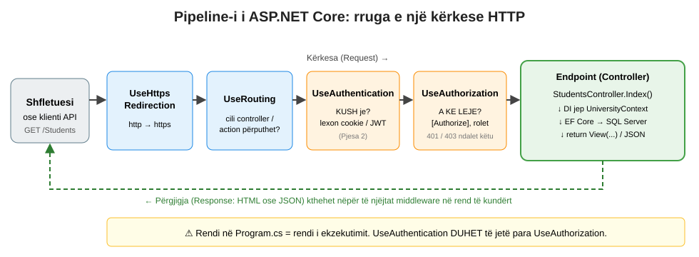
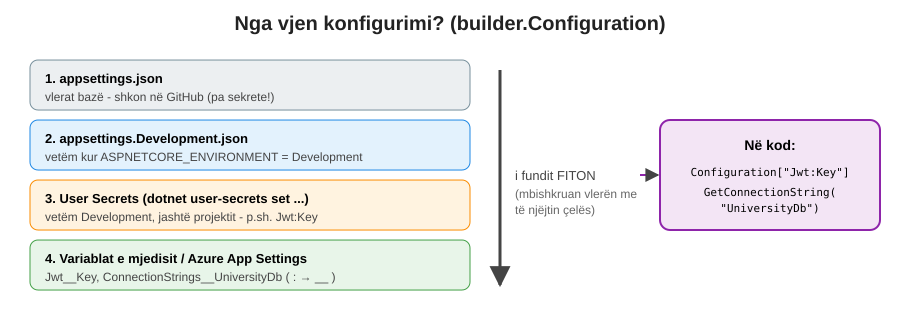
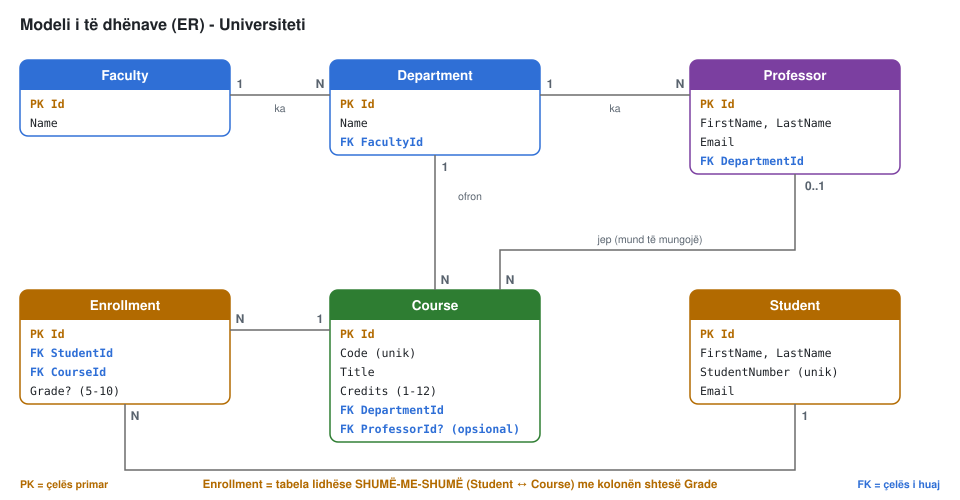
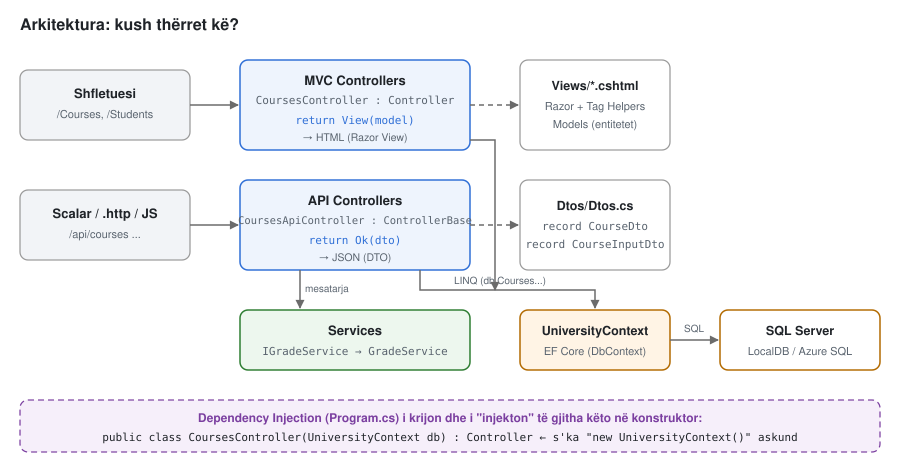
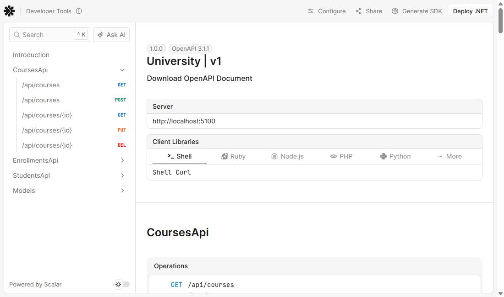
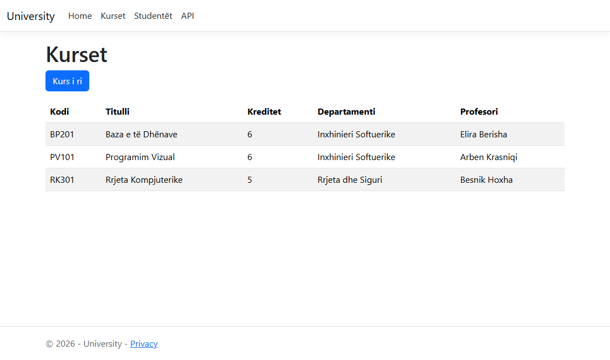
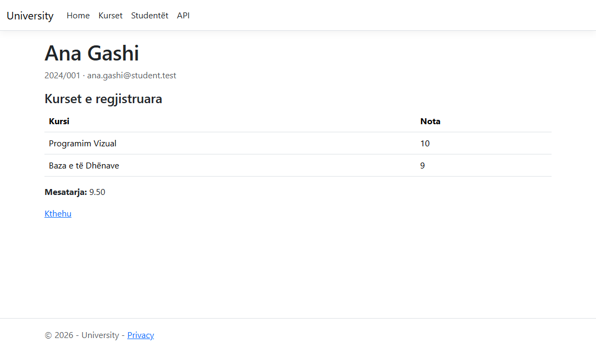

# Pjesa 1: Aplikacioni "Universiteti" (MVC + Web API + EF Core 10)

> **Kohëzgjatja:** rreth 2 orë · **Parakushte:** Visual Studio 2026 (ose VS Code), .NET 10 SDK, SQL Server LocalDB

## Përmbajtja

0. [Hyrje: si duket një projekt ASP.NET Core 10](#0-hyrje-si-duket-një-projekt-aspnet-core-10)
1. [Tema: sistemi i një universiteti](#1-tema-sistemi-i-një-universiteti)
2. [Arkitektura: kush thërret kë?](#2-arkitektura-kush-thërret-kë)
3. [Hapat](#3-hapat)
4. [Gabime të shpeshta](#4-gabime-të-shpeshta)
5. [Pyetje kontrolli](#5-pyetje-kontrolli-pjesa-1)

---

## 0. Hyrje: si duket një projekt ASP.NET Core 10

Deri tani keni punuar me **ASP.NET MVC 5** (.NET Framework 4.8). Tani kalojmë te **ASP.NET Core 10**. Konceptet janë të njëjta (Model, View, Controller, routing, Razor), por **struktura e projektit dhe mënyra e konfigurimit ndryshojnë shumë**. Para se të shkruajmë kod, le ta njohim terrenin.

### 0.1 Çfarë është .NET 10?

| | .NET Framework 4.8 (MVC5) | .NET 10 (ASP.NET Core) |
|---|---|---|
| Platforma | vetëm Windows | Windows, Linux, macOS |
| Kodi burimor | i mbyllur (kryesisht) | open source (GitHub) |
| Serveri web | IIS (i detyrueshëm) | **Kestrel** (i integruar), opsionalisht pas IIS/Nginx |
| Zhvillimi | vetëm mirëmbajtje, pa veçori të reja | version i ri çdo vit, **.NET 10 = LTS** (mbështetje deri në nëntor 2028) |
| Performanca | e mirë | ndër framework-et web më të shpejta |

> 💡 Meqë Core 10 punon në **Linux**, në Pjesën 2 do ta publikojmë në një Azure App Service Linux (planin falas F1).

### 0.2 Struktura e skedarëve

Kur krijoni projektin me shabllonin **ASP.NET Core Web App (Model-View-Controller)**, merrni këtë strukturë (këtu me dosjet që do t'i shtojmë ne):

```text
University/
├── University.slnx              ← "Solution" (formati i ri XML i .NET 10; më parë .sln)
└── University/
    ├── University.csproj        ← projekti: versioni i .NET + paketat NuGet
    ├── Program.cs               ← ★ PIKA E NISJES: shërbimet + pipeline-i (zëvendëson Global.asax, App_Start, Startup)
    ├── appsettings.json         ← konfigurimi (zëvendëson Web.config)
    ├── appsettings.Development.json  ← konfigurim vetëm për zhvillim
    ├── University.http          ← kërkesa HTTP për testimin e API-së direkt nga VS
    ├── Properties/
    │   └── launchSettings.json  ← portat (http/https) dhe ambienti kur shtypni F5
    ├── wwwroot/                 ← skedarët statikë: css/, js/, lib/ (Bootstrap, jQuery), favicon
    ├── Controllers/             ← controller-at MVC (kthejnë HTML)
    │   └── Api/                 ← (ne) controller-at Web API (kthejnë JSON)
    ├── Models/                  ← entitetet dhe ViewModel-et
    ├── Views/                   ← Razor View-t (.cshtml)
    │   ├── Shared/_Layout.cshtml    ← korniza e përbashkët e faqeve
    │   ├── _ViewImports.cshtml      ← @using dhe Tag Helper-at për të gjitha View-t
    │   └── _ViewStart.cshtml        ← cakton _Layout si layout default
    ├── Data/                    ← (ne) DbContext-i dhe të dhënat fillestare
    ├── Dtos/                    ← (ne) objektet që shkojnë/vijnë nga API
    ├── Services/                ← (ne) logjika e biznesit (p.sh. mesatarja)
    ├── Migrations/              ← (gjenerohet) migrimet e EF Core
    ├── bin/  obj/               ← (gjenerohen) rezultati i kompajlimit - mos i prekni, mos i dërgoni në Git
```

**Çfarë NUK ka më** (krahasuar me MVC5): `Global.asax`, `Web.config`, `packages.config`, `App_Start/`, `Content/`, `Scripts/`, `BundleConfig`. Gjithçka u zhvendos te `Program.cs`, `appsettings.json`, `.csproj` dhe `wwwroot/`.

### 0.3 Nga MVC5 te Core 10: çfarë u bë çfarë

| MVC 5 (.NET Framework) | ASP.NET Core 10 |
|---|---|
| `Global.asax` + `App_Start/RouteConfig.cs` | `Program.cs` → `app.MapControllerRoute(...)` |
| `Web.config` (`<connectionStrings>`, `<appSettings>`) | `appsettings.json` + **User Secrets** + variabla mjedisi |
| `packages.config` | `<PackageReference>` brenda `.csproj` |
| `Content/`, `Scripts/`, `BundleConfig` | `wwwroot/` + `app.MapStaticAssets()` |
| Pa DI të integruar (Unity, Ninject...) | **Dependency Injection i integruar** |
| Web API 2: `ApiController` i veçantë | i njëjti framework: `ControllerBase` + `[ApiController]` |
| Entity Framework 6 | **Entity Framework Core 10** |
| Swagger (Swashbuckle) | **OpenAPI i integruar** + Scalar UI |
| ASP.NET Identity 2 (OWIN) | **ASP.NET Core Identity** |
| `System.Web.Mvc` | `Microsoft.AspNetCore.Mvc` |
| `@Html.ActionLink(...)` | Tag Helpers: `<a asp-action="..." asp-controller="...">` |

### 0.4 `Program.cs`: zemra e aplikacionit

`Program.cs` ka **dy faza**. Mbajeni mend këtë ndarje, sepse çdo gjë që shtojmë në këtë ushtrim shkon në njërën prej tyre:

```csharp
var builder = WebApplication.CreateBuilder(args);

// ── FAZA 1: SHËRBIMET ── "Çfarë mjetesh ka aplikacioni?"
builder.Services.AddControllersWithViews();          // MVC + API
builder.Services.AddDbContext<UniversityContext>(...); // EF Core
builder.Services.AddScoped<IGradeService, GradeService>(); // shërbimi ynë

var app = builder.Build();   // ← kufiri: pas kësaj s'shtohen shërbime

// ── FAZA 2: PIPELINE-I ── "Nëpër çfarë hapash kalon çdo kërkesë?"
app.UseHttpsRedirection();
app.UseRouting();
app.UseAuthorization();
app.MapControllerRoute("default", "{controller=Home}/{action=Index}/{id?}");

app.Run();   // nis serverin Kestrel
```

> Nuk ka `class Program` dhe as `static void Main`. Këto quhen **top-level statements**: kompajleri i gjeneron vetë.

### 0.5 Pipeline-i (middleware)

Çdo kërkesë HTTP kalon nëpër një **zinxhir middleware-sh**, me radhën që i keni shkruar në `Program.cs`. Secili mund ta **përpunojë** kërkesën dhe ta kalojë më tej, ose ta **ndalë** (p.sh. `UseAuthorization` kthen 401/403 pa e arritur fare controller-in).



### 0.6 Dependency Injection (DI)

Në MVC5 shkruanit `private UniversityContext db = new UniversityContext();` brenda controller-it. Në Core **nuk krijoni vetë** objektet që ju duhen. I **kërkoni** te konstruktori dhe **DI container**-i jua jep:

```csharp
// 1) Regjistrimi (Program.cs)
builder.Services.AddScoped<IGradeService, GradeService>();

// 2) Përdorimi: controller-i thjesht e kërkon në konstruktor
public class StudentsController(UniversityContext db, IGradeService grades) : Controller
{
    // db dhe grades janë gati, s'ka "new"
}
```

| Jetëgjatësia | Metoda | Kur krijohet objekti | Shembull |
|---|---|---|---|
| **Singleton** | `AddSingleton` | një herë për gjithë aplikacionin | cache, konfigurim |
| **Scoped** | `AddScoped` | një herë për **çdo kërkesë HTTP** | `DbContext`, shërbimet tona |
| **Transient** | `AddTransient` | sa herë që kërkohet | objekte të vogla pa gjendje |

**Pse?** Controller-i varet nga një **interface** (`IGradeService`), jo nga klasa konkrete. Kështu klasën mund ta ndërroni pa prekur controller-in dhe mund ta **testoni** veçmas (Pjesa 2).

### 0.7 Konfigurimi

`builder.Configuration` bashkon vlerat nga disa burime. Nëse i njëjti çelës gjendet në më shumë se një vend, **fiton burimi i fundit**:



> 🔐 **Rregull i artë:** asnjë fjalëkalim apo çelës sekret në `appsettings.json`, sepse ai skedar shkon në GitHub. Lokalisht përdorni **User Secrets**; në Azure përdorni **App Settings**.

### 0.8 Komandat bazë të `dotnet` CLI

Visual Studio i ekzekuton këto në prapaskenë. Është mirë t'i njihni, sepse funksionojnë njësoj në Windows, Linux dhe Mac:

| Komanda | Çfarë bën |
|---|---|
| `dotnet --version` | tregon versionin e SDK (duhet `10.0.x`) |
| `dotnet new mvc -n University` | krijon projekt të ri MVC |
| `dotnet build` | kompajlon |
| `dotnet run` | kompajlon dhe nis aplikacionin |
| `dotnet watch` | nis dhe **rifreskon automatikisht** kur ndryshoni kodin |
| `dotnet add package Emri --version "10.0.*"` | shton paketë NuGet |
| `dotnet ef migrations add Emri` | krijon migrim (EF Core) |
| `dotnet ef database update` | aplikon migrimet në bazë |

> ⚠️ Kur shtoni paketa me `dotnet add package`, shkruani **gjithmonë** `--version "10.0.*"`. Pa të, mund të instalohet një version *preview* i .NET 11 që nuk përputhet me projektin (gabimi `NU1202 ... is not compatible with net10.0`).

### ✅ Pyetje kontrolli (Hyrja)

1. Cili skedar zëvendëson `Global.asax` dhe `RouteConfig.cs`? Po `Web.config`-un?
2. Ku shkojnë skedarët CSS dhe JS në Core 10?
3. Cilat janë dy fazat e `Program.cs`? Çfarë ndodh te `builder.Build()`?
4. Pse `app.UseAuthentication()` duhet të jetë **para** `app.UseAuthorization()`?
5. Çfarë jetëgjatësie ka `DbContext`-i dhe pse?
6. Nëse `Jwt:Key` është edhe në `appsettings.json` edhe në User Secrets, cila vlerë përdoret?

---

## 1. Tema: sistemi i një universiteti

Do ndërtojmë një aplikacion të vogël për menaxhimin e një universiteti. Ai ka dy "fytyra":

- **faqe web (MVC)** për njerëzit: lista e kurseve, shtimi i kursit, lista e studentëve, detajet me notat dhe mesataren;
- **Web API (JSON)** për programet e tjera (një aplikacion mobil, JavaScript, Postman...): CRUD për kurset dhe studentët, regjistrimi në kurse dhe vendosja e notave.

### 1.1 Entitetet dhe lidhjet

| Entiteti | Çfarë paraqet | Lidhjet |
|---|---|---|
| **Faculty** | Fakulteti (p.sh. Fakulteti i Shkencave të Informatikës) | ka shumë departamente (1:N) |
| **Department** | Departamenti (p.sh. Inxhinieri Softuerike) | i takon 1 fakulteti; ka shumë profesorë dhe kurse |
| **Professor** | Profesori | i takon 1 departamenti; jep 0 ose më shumë kurse |
| **Course** | Kursi (p.sh. PV101 Programim Vizual) | i takon 1 departamenti; ka **0 ose 1** profesor |
| **Student** | Studenti | regjistrohet në shumë kurse |
| **Enrollment** | Regjistrimi + **nota** | lidh 1 student me 1 kurs |



**Lidhja shumë-me-shumë (N:M).** Një student ndjek shumë kurse dhe një kurs ka shumë studentë. Në bazë kjo **nuk** mund të ruhet me një kolonë të vetme, prandaj krijojmë tabelën lidhëse `Enrollment`. Ajo ka edhe një kolonë shtesë, `Grade` (nota), dhe për këtë arsye e modelojmë si **entitet të plotë**, jo si lidhje "të fshehtë" N:M.

**Rregullat e biznesit** që do t'i zbatojmë:

| Rregulli | Ku zbatohet |
|---|---|
| Kodi i kursit (`PV101`) është unik | indeks unik në bazë + kontroll në controller (409) |
| Numri i indeksit të studentit është unik | indeks unik + 409 |
| Një student nuk regjistrohet dy herë në të njëjtin kurs | indeks unik `(StudentId, CourseId)` + 409 |
| Kreditet 1-12, nota 5-10 | atributet `[Range]` (400 automatik) |
| Kursi me studentë të regjistruar nuk fshihet | kontroll në `DELETE` (409) |
| Mesatarja llogaritet vetëm nga kurset **me notë** | `GradeService` |

### 1.2 Të dhënat fillestare (seed)

Që të mos e nisni me bazë bosh, `SeedData` krijon automatikisht në nisjen e parë:

| Studentët | Kurset | Regjistrimet (Id) |
|---|---|---|
| 1 Ana Gashi (2024/001) | 1 PV101 Programim Vizual | 1: Ana - PV101, nota 10 |
| 2 Dren Morina (2024/002) | 2 BP201 Baza e të Dhënave | 2: Ana - BP201, nota 9 |
| 3 Liridona Shala (2024/003) | 3 RK301 Rrjeta Kompjuterike | 3: Dren - PV101, nota 8 |
| | | 4: Liridona - RK301, **pa notë** |

Kjo është arsyeja pse Ana ka mesataren **9.5**.

---

## 2. Arkitektura: kush thërret kë?



| | Controller MVC | Controller API |
|---|---|---|
| Trashëgon nga | `Controller` | `ControllerBase` |
| Atributi | - | `[ApiController]` + `[Route("api/...")]` |
| Kthen | `View(model)` → **HTML** | `Ok(dto)`, `NotFound()`... → **JSON** |
| Përdor | entitetet (`Course`) direkt te View | **DTO** (`CourseDto`) |
| Validimi | `if (!ModelState.IsValid) return View(...)` | automatik: **400 + ProblemDetails** |
| Shembull | `CoursesController` → `/Courses` | `CoursesApiController` → `/api/courses` |

Të dy llojet jetojnë **në të njëjtin projekt**, përdorin **të njëjtin** `UniversityContext` dhe **të njëjtin** `IGradeService`. Në MVC5 Web API ishte framework më vete; në Core është i njëjti.

---

## 3. Hapat

> 📁 **Kodi i gatshëm:** çdo skedar që përmendet më poshtë gjendet te [`Kodi/Pjesa1/`](Kodi/Pjesa1), me komente në shqip që shpjegojnë çdo rresht të rëndësishëm. **Mos e kopjoni verbërisht**: lexoni komentet, sepse pyetjet e kontrollit dalin prej tyre.
>
> Projekti **duhet** të quhet `University`. Përndryshe `namespace University...` në skedarë nuk përputhet.

### Hapi 1: Krijo projektin

**Visual Studio 2026:** *Create a new project* → **ASP.NET Core Web App (Model-View-Controller)** → emri `University` → *Framework:* **.NET 10.0 (Long Term Support)** → *Authentication type:* **None** (Identity e shtojmë vetë në Pjesën 2) → ✅ *Configure for HTTPS* → **Create**.

**Ose me CLI:**

```bash
dotnet new mvc -n University
cd University
```

Shtyp **F5** (ose `dotnet run`). Duhet të hapet faqja "Welcome". Ky është shablloni bosh. Shikojeni strukturën dhe krahasojeni me seksionin 0.2.

> 💡 **Sqarim:**
> - Shablloni **MVC** na jep gjithçka për faqet (Controllers, Views, `wwwroot` me Bootstrap). Web API-në e shtojmë në të njëjtin projekt, sepse në ASP.NET Core MVC dhe API janë **i njëjti framework** (në MVC5 ishin dy: `System.Web.Mvc` dhe `System.Web.Http`).
> - *Authentication: None*: nëse zgjidhni *Individual Accounts*, shablloni gjeneron qindra rreshta Identity që s'i kuptoni ende. Në Pjesën 2 e shtojmë vetë, hap pas hapi.
> - Herën e parë shfletuesi mund të pyesë për certifikatën **HTTPS** të zhvillimit → **Yes** (ose `dotnet dev-certs https --trust`).
> - `dotnet run` nuk e mbyll terminalin: aplikacioni punon derisa shtypni **Ctrl+C**.

### Hapi 2: Shto paketat NuGet

**Package Manager Console** (*Tools → NuGet Package Manager*) ose terminal në dosjen e projektit:

```bash
dotnet add package Microsoft.EntityFrameworkCore.SqlServer --version "10.0.*"
dotnet add package Microsoft.EntityFrameworkCore.Design    --version "10.0.*"
dotnet add package Microsoft.AspNetCore.OpenApi            --version "10.0.*"
dotnet add package Scalar.AspNetCore
```

| Paketa | Për çfarë |
|---|---|
| `EntityFrameworkCore.SqlServer` | EF Core + "drajveri" për SQL Server |
| `EntityFrameworkCore.Design` | nevojitet nga komandat e migrimit |
| `AspNetCore.OpenApi` | gjeneron dokumentin `/openapi/v1.json` |
| `Scalar.AspNetCore` | UI e bukur për ta provuar API-në (zëvendëson Swagger UI) |

Instalo edhe mjetin e migrimeve (një herë për kompjuter):

```bash
dotnet tool install --global dotnet-ef
```

> Në Visual Studio mund të përdorni edhe *Add-Migration* / *Update-Database* te Package Manager Console. Për këtë duhet edhe paketa `Microsoft.EntityFrameworkCore.Tools --version "10.0.*"`.

Hapni `University.csproj` (dy-klik mbi projektin). Paketat shfaqen si `<PackageReference>`. Kjo zëvendëson `packages.config` të MVC5.

> 💡 **Sqarim:**
> - **NuGet** është "dyqani" i librarive .NET. `dotnet add package` shkarkon paketën dhe e shton te `.csproj`; dosja `bin/` mbush DLL-të gjatë build-it.
> - Pse `--version "10.0.*"`? Pa të, NuGet mund të marrë versionin më të ri (p.sh. preview për .NET 11), që s'punon me `net10.0` → gabimi `NU1202`. `10.0.*` do të thotë "versioni më i ri **10.0.x**".
> - `dotnet-ef` është **mjet** (program), jo librari: instalohet një herë në kompjuter, jo në projekt. `--global` e bën të disponueshëm në çdo terminal.
> - Kontrollo: `dotnet build` duhet të përfundojë me **Build succeeded**.

### Hapi 3: Modelet (entitetet)

Krijo `Models/Entities.cs` (nga [`Kodi/Pjesa1/Models/Entities.cs`](Kodi/Pjesa1/Models/Entities.cs)). Konventat e EF Core:

```csharp
public class Course
{
    public int Id { get; set; }                 // "Id" → PRIMARY KEY (IDENTITY)

    [Required, StringLength(10)]
    public string Code { get; set; } = "";      // NOT NULL nvarchar(10)

    public int DepartmentId { get; set; }       // çelës i huaj...
    public Department? Department { get; set; } // ...+ navigation property

    public int? ProfessorId { get; set; }       // "int?" → kolona lejon NULL (opsionale)
    public Professor? Professor { get; set; }

    public List<Enrollment> Enrollments { get; set; } = [];  // ana "shumë"
}
```

> ❓ Pse `= ""` dhe `?`? Projektet .NET 10 kanë **Nullable reference types** të aktivizuara: kompajleri ju paralajmëron kur një `string` mund të jetë `null`. `string?` do të thotë "mund të mungojë"; `string = ""` do të thotë "gjithmonë ka vlerë".

> 💡 **Sqarim: si e "lexon" EF Core klasën?**
>
> | Në C# | Në SQL Server |
> |---|---|
> | klasa `Course` + `DbSet<Course> Courses` | tabela `Courses` |
> | `public int Id` | `Id int IDENTITY PRIMARY KEY` |
> | `[Required, StringLength(10)] string Code` | `Code nvarchar(10) NOT NULL` |
> | `int DepartmentId` + `Department? Department` | `DepartmentId int NOT NULL` + `FOREIGN KEY` → `Departments(Id)` |
> | `int? ProfessorId` | `ProfessorId int NULL` |
> | `List<Enrollment> Enrollments` | **asnjë kolonë**: është ana tjetër e FK-së te `Enrollments.CourseId` |
>
> **Navigation property** (`Department`, `Enrollments`) është për C#: ju lejon të shkruani `course.Department.Name` në vend të një JOIN-i manual. Atributet `[Required]`, `[Range]` përdoren **dy herë**: për skemën e bazës dhe për validimin e formave/API-së.

### Hapi 4: DbContext

Krijo dosjen `Data/` dhe skedarin `Data/UniversityContext.cs` ([kodi](Kodi/Pjesa1/Data/UniversityContext.cs)). Pjesët kryesore:

```csharp
public class UniversityContext(DbContextOptions<UniversityContext> options) : DbContext(options)
{
    public DbSet<Course> Courses => Set<Course>();   // tabela Courses
    // ...

    protected override void OnModelCreating(ModelBuilder modelBuilder)
    {
        modelBuilder.Entity<Course>().HasIndex(c => c.Code).IsUnique();  // UNIQUE INDEX
        modelBuilder.Entity<Course>()
            .HasOne(c => c.Department).WithMany(d => d.Courses)
            .OnDelete(DeleteBehavior.Restrict);   // shih komentin te kodi: "multiple cascade paths"
    }
}
```

Ndryshimi nga MVC5: konstruktori **merr opsionet** (`DbContextOptions`) nga DI. Nuk e shkruan connection string-un brenda klasës.

> 💡 **Sqarim:**
> - **DbContext** është "ura" mes C# dhe bazës: çdo `DbSet` është një tabelë, dhe `SaveChangesAsync()` i kthen ndryshimet në `INSERT`/`UPDATE`/`DELETE`.
> - `(DbContextOptions<UniversityContext> options)` pas emrit të klasës është **primary constructor** (C# 12): shkurtesë për konstruktorin klasik.
> - `OnModelCreating` përdoret për rregullat që s'shprehen dot me atribute: indekse unike, lidhje me shumë FK, sjellja gjatë fshirjes.
> - Pse `DeleteBehavior.Restrict`? Nga `Department` te `Course` ka **dy rrugë** fshirjeje: direkt (Department → Course) dhe përmes profesorit (Department → Professor → Course). SQL Server nuk lejon dy rrugë cascade drejt së njëjtës tabelë (*multiple cascade paths*). Me `Restrict`, departamenti që ka kurse thjesht s'mund të fshihet. Te `Professor` përdorim `SetNull`: nëse fshihet profesori, kurset mbeten pa profesor.

### Hapi 5: Të dhënat fillestare

Krijo `Data/SeedData.cs` ([kodi](Kodi/Pjesa1/Data/SeedData.cs)). Metoda `Initialize` kontrollon `if (db.Faculties.Any()) return;`, kështu që të dhënat shtohen **vetëm herën e parë**.

> 💡 **Sqarim:** të dhënat ruhen **me radhë**: fakulteti → departamentet dhe profesorët → `SaveChanges()` → kurset dhe studentët → regjistrimet. Pse? Kursi ka nevojë për `DepartmentId`, dhe ky Id ekziston vetëm **pasi** departamenti është ruajtur (SQL Server e gjeneron me `IDENTITY`). Nëse doni t'i rifusni të dhënat nga fillimi, fshini bazën (*SQL Server Object Explorer* → `UniversityCoreDb` → **Delete**) dhe rinisni aplikacionin.

### Hapi 6: Shërbimi i notave (logjika e biznesit)

Krijo `Services/GradeService.cs` ([kodi](Kodi/Pjesa1/Services/GradeService.cs)):

```csharp
public interface IGradeService { double? Average(IEnumerable<int?> grades); }

public class GradeService : IGradeService
{
    public double? Average(IEnumerable<int?> grades)
    {
        var graded = grades.Where(g => g.HasValue).Select(g => g!.Value).ToList();
        return graded.Count == 0 ? null : Math.Round(graded.Average(), 2);
    }
}
```

Pse jo direkt te controller-i? Sepse mesatarja duhet **edhe** te faqja MVC **edhe** te API. Kështu logjika shkruhet **një herë**, dhe në Pjesën 2 e testojmë me xUnit pa bazë e pa web server.

> 💡 **Sqarim: Dependency Injection (DI) me një shembull.** Controller-i **nuk** shkruan `new GradeService()`. Ai thjesht e kërkon në konstruktor:
>
> ```csharp
> public class StudentsController(UniversityContext db, IGradeService grades) : Controller
> ```
>
> Kur vjen kërkesa, ASP.NET Core sheh se i duhen `UniversityContext` dhe `IGradeService`, i gjen te lista e regjistruar në `Program.cs` dhe i krijon vetë. **Scoped** do të thotë: një objekt i ri për çdo kërkesë HTTP. Nëse harroni ta regjistroni, merrni gabimin `Unable to resolve service for type 'IGradeService'`.

### Hapi 7: Connection string dhe `Program.cs`

Zëvendëso `appsettings.json` ([kodi](Kodi/Pjesa1/appsettings.json)). Seksioni i ri:

```json
"ConnectionStrings": {
  "UniversityDb": "Server=(localdb)\\MSSQLLocalDB;Database=UniversityCoreDb;Trusted_Connection=True;TrustServerCertificate=True"
}
```

> Ky connection string **nuk ka fjalëkalim** (Windows Authentication), prandaj lejohet në `appsettings.json`. Për Azure SQL (me fjalëkalim) do përdorim App Settings në Pjesën 2.

Zëvendëso `Program.cs` ([kodi](Kodi/Pjesa1/Program.cs)). Krahasojeni me shabllonin. U shtuan:

| Rreshti | Faza | Çfarë bën |
|---|---|---|
| `AddOpenApi()` | shërbimet | dokumenti OpenAPI |
| `AddDbContext<UniversityContext>(... UseSqlServer(...))` | shërbimet | regjistron EF Core me connection string-un `UniversityDb` |
| `AddScoped<IGradeService, GradeService>()` | shërbimet | regjistron shërbimin tonë |
| `db.Database.Migrate(); SeedData.Initialize(db);` | nisja | krijon/përditëson bazën dhe e mbush |
| `MapOpenApi(); MapScalarApiReference();` | pipeline | `/openapi/v1.json` dhe `/scalar` (vetëm në Development) |

> `EnableRetryOnFailure()` provon sërish automatikisht nëse lidhja me SQL dështon përkohësisht. Kjo do na duhet në Azure, ku baza falas "fle" dhe zgjohet me vonesë.

> 💡 **Sqarim: si arrin connection string-u te DbContext-i?**
>
> 1. `appsettings.json` → `"ConnectionStrings": { "UniversityDb": "..." }`
> 2. `builder.Configuration.GetConnectionString("UniversityDb")` e lexon vlerën (ose nga variablat e mjedisit, në Azure)
> 3. `AddDbContext(... UseSqlServer(cs))` e ruan te `DbContextOptions`
> 4. DI ia jep opsionet konstruktorit `UniversityContext(DbContextOptions<...> options)`
>
> `(localdb)\MSSQLLocalDB` është SQL Server i vogël që vjen me Visual Studio; `Database=UniversityCoreDb` krijohet automatikisht. Blloku me `CreateScope()` nevojitet sepse DbContext-i është *scoped* (jeton brenda një kërkese), ndërsa në nisje ende s'ka kërkesë.

### Hapi 8: Migrimi i parë

```bash
dotnet ef migrations add InitialCreate
```

(VS: `Add-Migration InitialCreate`.) Lind dosja `Migrations/`. Hapni skedarin `..._InitialCreate.cs` dhe gjeni `CreateTable(name: "Courses"...)` dhe `CreateIndex(... unique: true)`. Ky është SQL-i juaj, i shkruar në C#.

**Nuk ka nevojë** për `dotnet ef database update`, sepse `db.Database.Migrate()` në `Program.cs` e aplikon migrimin në nisje.

> 💡 **Sqarim: çfarë është migrimi?** Një "fotografi" e ndryshimeve të modelit, si commit në Git për bazën. EF Core krahason klasat tuaja me `Migrations/UniversityContextModelSnapshot.cs` dhe shkruan vetëm diferencën. Në bazë krijohet tabela `__EFMigrationsHistory`, ku ruhet cilat migrime janë aplikuar, kështu që `Migrate()` aplikon vetëm ato të rejat.
>
> Rregulli: **ndryshove modelin → migrim i ri** (`dotnet ef migrations add EmriPershkrues`). Mos i ndryshoni me dorë migrimet e aplikuara. Nëse gaboni para se ta aplikoni: `dotnet ef migrations remove`.

### Hapi 9: DTO-të dhe controller-at API

1. Krijo `Dtos/Dtos.cs` ([kodi](Kodi/Pjesa1/Dtos/Dtos.cs)). Lexo komentin në krye: **pse DTO dhe jo entiteti direkt**.
2. Krijo dosjen `Controllers/Api/` me tre controller-a:
   - [`CoursesApiController.cs`](Kodi/Pjesa1/Controllers/Api/CoursesApiController.cs): CRUD i plotë
   - [`StudentsApiController.cs`](Kodi/Pjesa1/Controllers/Api/StudentsApiController.cs): lista, detajet me mesatare, krijimi
   - [`EnrollmentsApiController.cs`](Kodi/Pjesa1/Controllers/Api/EnrollmentsApiController.cs): regjistrimi dhe nota

> 💡 **Sqarim: anatomia e një API controller-i.**
>
> ```csharp
> [ApiController]                    // validim automatik → 400 me ProblemDetails, pa if (!ModelState.IsValid)
> [Route("api/courses")]             // adresa bazë
> public class CoursesApiController(UniversityContext db) : ControllerBase   // ControllerBase = pa View
> {
>     [HttpGet("{id:int}")]          // GET /api/courses/5 ("int" = vetëm numra)
>     public async Task<ActionResult<CourseDto>> GetById(int id) { ... }
> }
> ```
>
> - `async`/`await`: gjatë pritjes së bazës, thread-i lirohet për kërkesa të tjera.
> - `ActionResult<CourseDto>`: mund të kthejë ose objektin (200), ose `NotFound()`, `Conflict()`...
> - `CreatedAtAction(...)` kthen **201** dhe header-in `Location: /api/courses/4`, ku klienti e gjen objektin e ri.
> - Emrat `CoursesApiController` dhe `CoursesController` (MVC) duhet të ndryshojnë; adresat i ndajmë me `[Route("api/...")]`.

Kodet e statusit që kthen API-ja jonë:

| Kodi | Kuptimi | Kur |
|---|---|---|
| **200 OK** | në rregull, ja të dhënat | `GET` |
| **201 Created** | u krijua (+ header `Location`) | `POST` i suksesshëm |
| **204 No Content** | u krye, s'ka çfarë të kthehet | `PUT`, `DELETE` |
| **400 Bad Request** | të dhëna të pavlefshme | `credits: 50`, departament që s'ekziston |
| **404 Not Found** | s'ekziston | `GET /api/courses/999` |
| **409 Conflict** | bie ndesh me gjendjen | kod i përsëritur, regjistrim i dyfishtë, fshirje e kursit me studentë |

Gabimet kthehen në formatin standard **ProblemDetails**:

```json
{
  "type": "https://tools.ietf.org/html/rfc9110#section-15.5.10",
  "title": "Conflict",
  "status": 409,
  "detail": "Kodi 'WEB201' ekziston tashmë."
}
```

> ❓ Pse e kontrollojmë kodin e dyfishtë në controller, kur kemi indeks unik në bazë? Sepse pa kontrollin, SQL hedh `DbUpdateException` dhe klienti merr **500 Internal Server Error**: një gabim *i serverit* për një problem *të klientit*.

### Hapi 10: Nis aplikacionin dhe hap Scalar

Shtyp **F5**. Në nisjen e parë krijohet baza `UniversityCoreDb` (mund të zgjasë disa sekonda). Hap:

- `https://localhost:PORTI/scalar/v1` (ose linku **API** në meny): dokumentimi interaktiv i API-së
- `https://localhost:PORTI/openapi/v1.json`: dokumenti OpenAPI (JSON)

Te Scalar zgjidh `GET /api/courses` → **Send**. Duhet të marrësh 3 kurset.



> 💡 **Sqarim:** **OpenAPI** është përshkrimi i API-së në JSON (endpoint-et, parametrat, modelet), i gjeneruar automatikisht nga controller-at. **Scalar** e lexon atë dokument dhe ndërton faqen interaktive. Në MVC5 përdornim Postman. Këtu testimi është i integruar, por vetëm në *Development*. Nëse s'hapet, shikoni terminalin/Output: aty shfaqet adresa `Now listening on: https://localhost:XXXX`.

### Hapi 11: Testo me skedarin `.http`

Zëvendëso `University.http` ([kodi](Kodi/Pjesa1/University.http)).

> ⚠️ **Porti:** hap `Properties/launchSettings.json` dhe gjej profilin `https` → `applicationUrl`, p.sh. `https://localhost:7295;http://localhost:5021`. Vendose portin **https** te rreshti i parë:
>
> ```http
> @host = https://localhost:7295
> ```

> 💡 **Sqarim: sintaksa e `.http`.** `@host = ...` është variabël, `{{host}}` e përdor. `###` ndan kërkesat. Pas rreshtit `POST ...` vijnë header-at (`Content-Type: application/json`), një **rresht bosh**, pastaj trupi JSON. Pa rreshtin bosh, JSON-i lexohet si header dhe merrni 400/415. Aplikacioni duhet të jetë **duke punuar** (F5) ndërsa dërgoni kërkesat.

Kliko **Send request** mbi secilën kërkesë dhe kontrollo kodin e statusit:

| # | Kërkesa | Pritet |
|---|---|---|
| 1-2 | `GET /api/courses`, `/api/courses/1` | 200 |
| 3 | `POST` kursi WEB201 | **201** |
| 4 | `POST` me `credits: 50` | **400** |
| 5 | dërgo sërish kërkesën 3 | **409** |
| 6 | `GET /api/students/1` | 200, `averageGrade: 9.5` |
| 7 | regjistro Liridonën në PV101 (dërgoje 2 herë) | **201**, pastaj **409** |
| 8 | nota 9 te regjistrimi 4 | **204** |

Pas kërkesës 8, `GET /api/students/3` tregon që Liridona ka mesataren 9.

### Hapi 12: Faqet MVC

Kopjo View-t dhe controller-at MVC:

| Skedari | Çfarë bën |
|---|---|
| [`Controllers/CoursesController.cs`](Kodi/Pjesa1/Controllers/CoursesController.cs) | lista + forma `Create` (GET/POST, `[ValidateAntiForgeryToken]`, `[Bind]`, PRG) |
| [`Controllers/StudentsController.cs`](Kodi/Pjesa1/Controllers/StudentsController.cs) | lista + detajet me mesatare (përdor `IGradeService`) |
| [`Views/Courses/Index.cshtml`](Kodi/Pjesa1/Views/Courses/Index.cshtml), [`Create.cshtml`](Kodi/Pjesa1/Views/Courses/Create.cshtml) | tabela dhe forma me Tag Helpers |
| [`Views/Students/Index.cshtml`](Kodi/Pjesa1/Views/Students/Index.cshtml), [`Details.cshtml`](Kodi/Pjesa1/Views/Students/Details.cshtml) | studentët dhe notat |
| [`Views/Shared/_Layout.cshtml`](Kodi/Pjesa1/Views/Shared/_Layout.cshtml) | menyja: Kurset, Studentët, API |
| [`Views/Home/Index.cshtml`](Kodi/Pjesa1/Views/Home/Index.cshtml), [`Views/_ViewImports.cshtml`](Kodi/Pjesa1/Views/_ViewImports.cshtml) | faqja kryesore, `@using University.Models` |

**Tag Helpers** zëvendësojnë `Html.*` helper-at e MVC5:

```cshtml
@* MVC5 *@
@Html.LabelFor(m => m.Code)
@Html.TextBoxFor(m => m.Code, new { @class = "form-control" })
@Html.ValidationMessageFor(m => m.Code)

@* Core 10: duket si HTML i zakonshëm *@
<label asp-for="Code" class="form-label"></label>
<input asp-for="Code" class="form-control" />
<span asp-validation-for="Code" class="text-danger"></span>
```

> 💡 **Sqarim: rrjedha e formës `Create`.**
>
> 1. `GET /Courses/Create` → controller-i mbush listat rënëse (`ViewBag.Departments`, `ViewBag.Professors`) dhe kthen formën bosh.
> 2. Përdoruesi shtyp **Ruaj** → `POST /Courses/Create`. **Model binding** i mbush fushat e `Course` nga emrat e inputeve (`name="Code"` → `course.Code`).
> 3. `[ValidateAntiForgeryToken]` kontrollon tokenin e fshehtë që `<form>` e shton vetë (mbrojtje nga CSRF).
> 4. Nëse `ModelState.IsValid == false` (ose kodi ekziston), kthejmë **të njëjtën** View me modelin: fushat mbeten të mbushura, gabimet shfaqen te `asp-validation-for`.
> 5. Nëse gjithçka është në rregull: `SaveChangesAsync()` → `RedirectToAction(nameof(Index))`. Ky është **PRG** (Post-Redirect-Get): refresh-i i faqes nuk e dërgon formën sërish.
>
> `asp-for="Code"` gjeneron `id`, `name`, `value` dhe atributet e validimit (`data-val-required`...) nga modeli. Prandaj mesazhi i gabimit shfaqet edhe **pa** dërguar formën, me JavaScript (`_ValidationScriptsPartial`).

Provo: **Kurset** → **Kurs i ri** → lëre *Kodi* bosh ose shkruaj `PV101` (ekziston) → **Ruaj**. Duhet të shohësh mesazhin e gabimit pa humbur të dhënat e formës.






### Hapi 13: Problemi i sigurisë (hyrje për Pjesën 2)

Aplikacioni punon, por **kushdo** mund të:

- shtojë apo fshijë kurse,
- shohë listën e studentëve me email-et e tyre,
- **vendosë nota**: `PUT /api/enrollments/3/grade { "grade": 10 }` dhe Dreni sapo e ka marrë 10-shin!

Kjo është **qëllimisht** kështu. Në [Pjesën 2](Pjesa2.md) shtojmë llogari përdoruesish, role (Admin, Professor, Student), cookie për faqet dhe JWT për API-në, pastaj e publikojmë në Azure.

---

## 4. Gabime të shpeshta

| Simptoma | Shkaku | Zgjidhja |
|---|---|---|
| `NU1202: Package ... is not compatible with net10.0` | u instalua versioni i .NET 11 (preview) | `dotnet remove package X`, pastaj `dotnet add package X --version "10.0.*"` |
| `The type or namespace name 'University' could not be found` | projekti s'quhet `University` | krijoni projektin me emrin e saktë ose ndryshoni `namespace`-et |
| `dotnet ef` : *command not found* | mjeti s'është instaluar | `dotnet tool install --global dotnet-ef`, pastaj rihapni terminalin |
| `Build failed` te `migrations add` | gabim kompajlimi diku në projekt | `dotnet build` dhe rregulloni gabimin e parë |
| `A network-related ... error ... SQL Server` | LocalDB s'është instaluar/nisur | `sqllocaldb info`; instaloni nga *Visual Studio Installer → Data storage* |
| `Introducing FOREIGN KEY constraint ... may cause cycles or multiple cascade paths` | mungon `OnDelete(DeleteBehavior.Restrict)` | kontrolloni `OnModelCreating` |
| `.http`: *No connection could be made* | porti te `@host` është gabim | merreni nga `launchSettings.json` (profili https) |
| Faqja `/scalar/v1` jep 404 | ambienti s'është *Development* | nisni me profilin `https` (VS) ose `dotnet run --launch-profile https` |
| `c.Department` është `null` te View | mungon `.Include(c => c.Department)` | shtoni `Include` te query |
| Ndryshova modelin, por baza s'ndryshoi | s'keni krijuar migrim të ri | `dotnet ef migrations add EmriNdryshimit` dhe rinisni |

---

## 5. Pyetje kontrolli (Pjesa 1)

> Përpiquni t'u përgjigjeni vetë, pastaj klikoni **Përgjigja** për ta krahasuar.

1. Pse `Enrollment` është entitet më vete dhe jo thjesht `List<Course>` te `Student`?

   <details><summary>Përgjigja</summary>

   Lidhja Student–Kurs është **shumë-me-shumë** dhe ka të dhënë **të vetën**: notën (`Grade`). Një `List<Course>` do krijonte vetëm tabelën lidhëse, pa vend për notën. Si entitet më vete, `Enrollment` ka Id, mund të përditësohet (`PUT /api/enrollments/4/grade`) dhe ka indeks unik (`StudentId + CourseId`) kundër regjistrimit të dyfishtë. Më vonë mund t'i shtohen fusha të tjera (data, semestri).
   </details>

2. Çfarë ndodh në bazë nëse `ProfessorId` është `int` në vend të `int?`?

   <details><summary>Përgjigja</summary>

   Kolona bëhet `NOT NULL`, pra **çdo** kurs duhet të ketë profesor: s'mund të krijohet kurs "pa profesor ende". Gjithashtu `SetNull` te `OnModelCreating` s'do funksiononte më: fshirja e profesorit s'mund ta bëjë kolonën `NULL`.
   </details>

3. Cili është ndryshimi mes `Controller` dhe `ControllerBase`? Pse API-ja përdor të dytin?

   <details><summary>Përgjigja</summary>

   `Controller` trashëgon nga `ControllerBase` dhe shton gjithçka për **View**: `View()`, `PartialView()`, `ViewBag`, `TempData`. API-ja kthen vetëm JSON, prandaj s'i duhen. `ControllerBase` ka `Ok()`, `NotFound()`, `Conflict()`, `CreatedAtAction()` etj.
   </details>

4. Përmendni dy arsye pse API-ja kthen `CourseDto` dhe jo `Course`.

   <details><summary>Përgjigja</summary>

   - **Cikle:** `Course → Department → Courses → ...` dhe serializimi JSON dështon ose kthen të dhëna të panevojshme.
   - **Kontrolli i të dhënave:** kthejmë vetëm fushat që duam (p.sh. `Department` si emër teksti në vend të objektit të plotë) dhe s'i ekspozojmë fushat e brendshme.
   - **Kontrata e qëndrueshme:** mund ta ndryshojmë bazën pa i prishur klientët e API-së.
   - **Overposting:** te `POST` pranojmë vetëm fushat e `CourseInputDto`, jo p.sh. `Id` apo `Enrollments`.
   </details>

5. Pse `DELETE /api/courses/1` kthen 409? Çfarë do të ndodhte pa atë kontroll?

   <details><summary>Përgjigja</summary>

   Kursi PV101 ka studentë të regjistruar (Ana, Dreni), me nota. Lidhja `Enrollment → Course` është e detyrueshme, prandaj EF e konfiguron me **cascade delete**: pa kontrollin, fshirja e kursit do **fshinte në heshtje edhe regjistrimet dhe notat** e studentëve. 409 i thotë klientit qartë: "s'mundet, sepse ka studentë të regjistruar; çregjistroji së pari".
   </details>

6. Çfarë bën `AsNoTracking()` dhe kur **nuk** duhet përdorur?

   <details><summary>Përgjigja</summary>

   Normalisht EF Core i "ndjek" (track) objektet e lexuara, që të dijë çfarë ndryshoi kur thirret `SaveChanges()`. `AsNoTracking()` e çaktivizon këtë: leximi është më i shpejtë dhe harxhon më pak memorie. **Nuk** përdoret kur objektin e lexojmë për ta **ndryshuar** dhe ruajtur (p.sh. `PUT`, vendosja e notës), sepse `SaveChanges()` s'do ta shihte ndryshimin.
   </details>

7. Ku regjistrohet `IGradeService` dhe si arrin te `StudentsController`?

   <details><summary>Përgjigja</summary>

   Te `Program.cs`: `builder.Services.AddScoped<IGradeService, GradeService>();`. Controller-i e kërkon në konstruktor (`StudentsController(UniversityContext db, IGradeService grades)`), dhe kontejneri DI krijon një `GradeService` për çdo kërkesë dhe ia jep. Controller-i s'e di (dhe s'i intereson) cila klasë konkrete është.
   </details>

8. Çfarë është PRG (Post-Redirect-Get) dhe ku e përdorim?

   <details><summary>Përgjigja</summary>

   Pas një `POST` të suksesshëm, s'kthejmë View direkt, por **ridrejtojmë** (`RedirectToAction(nameof(Index))`), dhe shfletuesi bën `GET`. Kështu, nëse përdoruesi shtyp **F5**, rifreskohet lista dhe forma **nuk** dërgohet sërish (s'krijohet kurs i dyfishtë). E përdorim te `CoursesController.Create` (POST).
   </details>

9. Pse `[Bind("Code,Title,...")]` te `Create`? Çfarë sulmi parandalon?

   <details><summary>Përgjigja</summary>

   **Overposting / mass assignment**. Pa `[Bind]`, model binding mbush **çdo** veti të `Course` që gjen në kërkesë. Sulmuesi mund të shtojë fusha që forma s'i ka (p.sh. `Id`, ose në raste të tjera `IsAdmin`, `Grade`). `[Bind]` lejon vetëm fushat e listuara. (Alternativa më e mirë: një ViewModel/DTO me vetëm këto fusha.)
   </details>

10. Gjeni 3 gjëra në aplikacion që një përdorues i panjohur **nuk duhet** të mund t'i bëjë.

    <details><summary>Përgjigja</summary>

    - të vendosë apo ndryshojë **nota** (`PUT /api/enrollments/{id}/grade`);
    - të krijojë, ndryshojë apo fshijë **kurse** (`/Courses/Create`, `POST/PUT/DELETE /api/courses`);
    - të shohë listën e **studentëve** me email-e (të dhëna personale);
    - të regjistrojë studentë të tjerë në kurse.

    Të gjitha zgjidhen në Pjesën 2.
    </details>

➡️ Vazhdo te **[Pjesa 2: Identity, JWT, testet dhe Azure](Pjesa2.md)**

