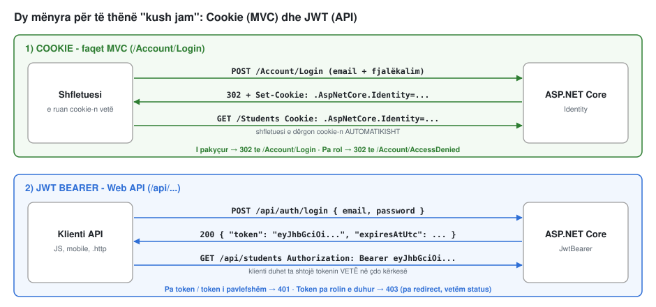
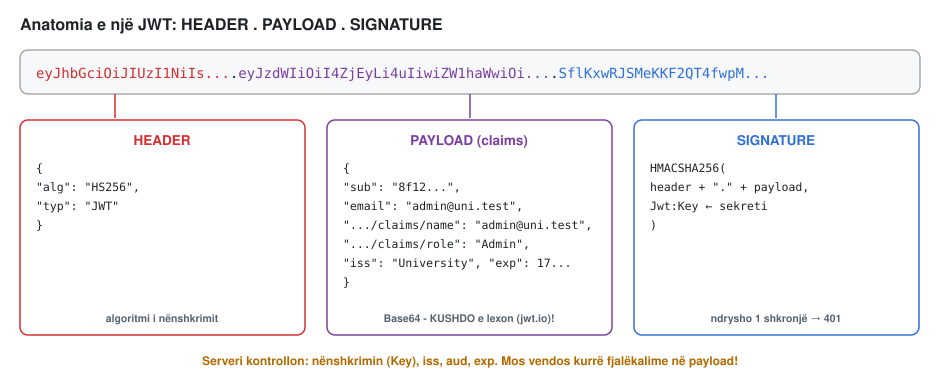
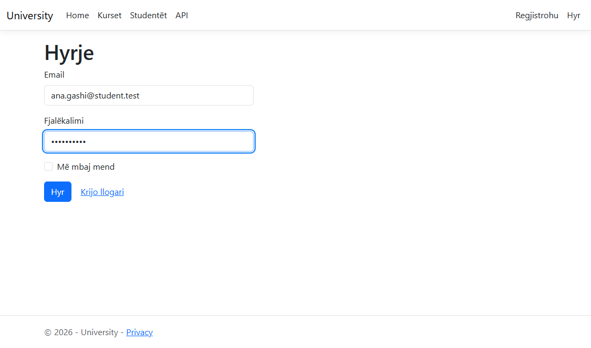
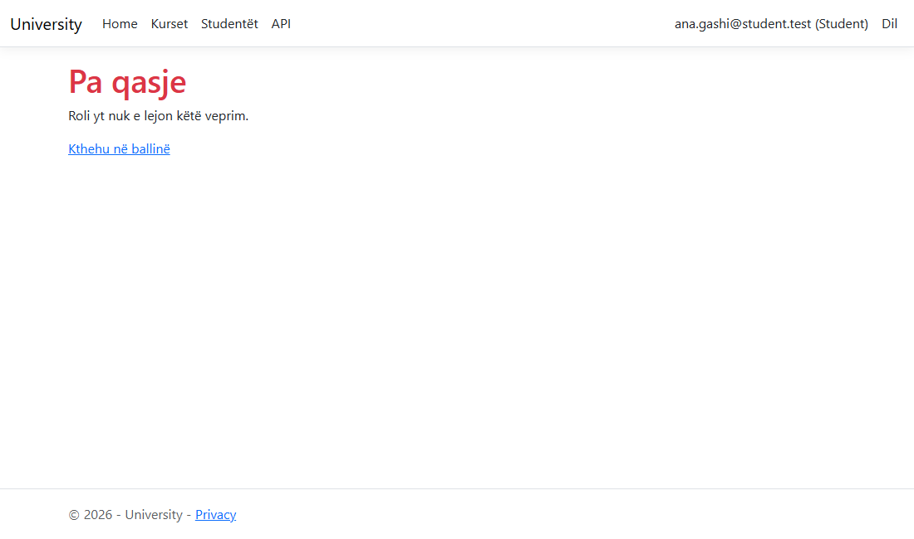
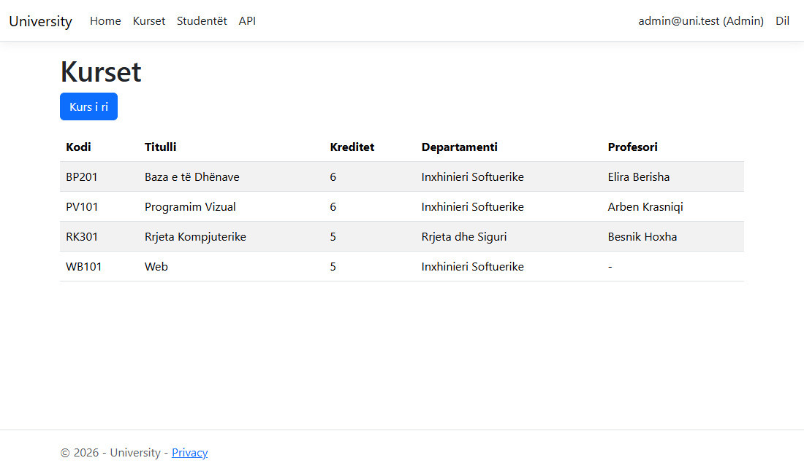
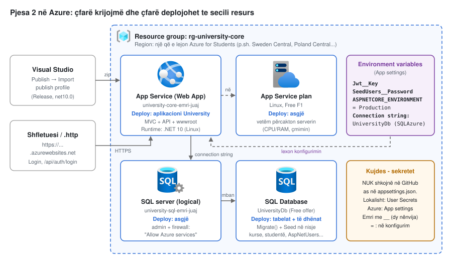

# Pjesa 2: Siguria (Identity + JWT), testet dhe publikimi në Azure

> **Kohëzgjatja:** rreth 2.5 orë · **Parakushte:** keni përfunduar [Pjesën 1](Pjesa1.md) (projekti `University` punon lokalisht) · llogari **Azure for Students**

## Përmbajtja

1. [Teoria: kush je dhe çfarë të lejohet?](#1-teoria-kush-je-dhe-çfarë-të-lejohet)
2. [Teoria: si duket një JWT](#2-teoria-si-duket-një-jwt)
3. [Hapat A: Identity, rolet dhe JWT](#3-hapat-a-identity-rolet-dhe-jwt)
4. [Hapat B: testet automatike (xUnit)](#4-hapat-b-testet-automatike-xunit)
5. [Teoria dhe hapat C: publikimi në Azure](#5-teoria-dhe-hapat-c-publikimi-në-azure)
6. [Gabime të shpeshta](#6-gabime-të-shpeshta)
7. [Pyetje kontrolli](#7-pyetje-kontrolli)
8. [Detyra shtesë](#8-detyra-shtesë)

---

## 1. Teoria: kush je dhe çfarë të lejohet?

Në fund të Pjesës 1 pamë që **kushdo** mund të vendosë nota. Na duhen dy gjëra të ndryshme:

| | **Autentikimi** (Authentication) | **Autorizimi** (Authorization) |
|---|---|---|
| Pyetja | **Kush je?** | **A ke leje?** |
| Si | email + fjalëkalim → cookie ose token | role (`Admin`), policy (`GradeEditors`), kontrolle në kod |
| Middleware | `app.UseAuthentication()` | `app.UseAuthorization()` |
| Kur dështon | **401 Unauthorized** (API) / redirect te `/Account/Login` (MVC) | **403 Forbidden** (API) / redirect te `/Account/AccessDenied` (MVC) |
| Analogjia | rojtari kontrollon letërnjoftimin | rojtari kontrollon a je në listën e sallës |

> Emri "401 Unauthorized" është historikisht i gabuar: në fakt do të thotë **"i paautentikuar"**. 403 është "e di kush je, por s'ke leje".

### 1.1 ASP.NET Core Identity

**Identity** është sistemi i gatshëm i Microsoft-it për përdoruesit. Ai:

- krijon tabelat `AspNetUsers`, `AspNetRoles`, `AspNetUserRoles`... në **të njëjtën bazë** me tabelat tona;
- ruan fjalëkalimet si **hash** (asnjëherë si tekst), bllokon llogarinë pas 5 tentimeve të gabuara;
- ofron shërbimet `UserManager` (krijo/gjej përdorues, role), `SignInManager` (kontrollo fjalëkalimin, krijo cookie), `RoleManager`.

### 1.2 Dy mënyra për ta "mbajtur mend" përdoruesin: cookie dhe JWT

HTTP është **pa gjendje**: serveri s'e mban mend kërkesën e kaluar. Pas login-it, klienti duhet ta dëshmojë identitetin **në çdo kërkesë**.



| | **Cookie** | **JWT Bearer** |
|---|---|---|
| Përdoret nga | faqet MVC në shfletues | Web API (JS, mobile, `.http`, Postman) |
| Kush e dërgon | shfletuesi **automatikisht** | klienti **vetë**, në header `Authorization: Bearer ...` |
| Kur s'je i kyçur | 302 → `/Account/Login` | **401** (pa redirect) |
| Ku e krijojmë | `AccountController` (`PasswordSignInAsync`) | `AuthApiController` + `JwtTokenService` |

Në projektin tonë përdorim **të dyja**: cookie është skema *default* (për MVC), kurse controller-at API e kërkojnë JWT-në me:

```csharp
[Authorize(AuthenticationSchemes = JwtBearerDefaults.AuthenticationScheme)]
```

### 1.3 Rolet dhe lejet

| Veprimi | Anonim | Student | Professor | Admin |
|---|:---:|:---:|:---:|:---:|
| Shiko kurset (MVC dhe `GET /api/courses`) | ✅ | ✅ | ✅ | ✅ |
| Shiko studentët (MVC `/Students`, `GET /api/students`) | ❌ | ✅ | ✅ | ✅ |
| Krijo/ndrysho/fshi kurs, krijo student | ❌ | ❌ | ❌ | ✅ |
| Regjistrohu në kurs | ❌ | ✅ **vetëm veten** | ❌ | ✅ këdo |
| Vendos notë | ❌ | ❌ | ✅ | ✅ |

Si i shprehim në kod:

```csharp
[Authorize]                                  // çdo përdorues i kyçur
[Authorize(Roles = "Admin")]                 // vetëm Admin
[Authorize(Roles = "Admin,Student")]         // Admin OSE Student
[Authorize(Policy = "GradeEditors")]         // rregull me emër, i definuar në Program.cs
[AllowAnonymous]                             // përjashtim: pa autentikim
```

---

## 2. Teoria: si duket një JWT

**JWT** (JSON Web Token, lexohet "xhot") është një varg teksti me **tri pjesë** të ndara me pikë:



1. **Header**: algoritmi i nënshkrimit (`HS256`).
2. **Payload**: *claims*, pra pohimet për përdoruesin: Id (`sub`), email-i, emri, **rolet**, skadimi (`exp`), lëshuesi (`iss`), marrësi (`aud`). Emrat e gjatë si `http://schemas.microsoft.com/ws/2008/06/identity/claims/role` janë emrat standardë të .NET për `ClaimTypes.Role` dhe `ClaimTypes.Name`.
3. **Signature**: `HMACSHA256(header + "." + payload, Jwt:Key)`.

Dy gjëra kyçe:

- 🔓 Payload-i është vetëm **Base64**, **jo i enkriptuar**. Kushdo e lexon te [jwt.io](https://jwt.io). Mos vendosni kurrë fjalëkalime apo të dhëna sekrete brenda.
- 🔏 Falë nënshkrimit, askush s'mund ta **ndryshojë** (p.sh. `"role": "Student"` → `"Admin"`) pa e ditur `Jwt:Key`. Serveri e rillogarit nënshkrimin dhe, nëse s'përputhet, kthen **401**.

Prandaj `Jwt:Key` është **sekret**. Nuk shkon në `appsettings.json` (GitHub), por në **User Secrets** lokalisht dhe në **App Settings** në Azure.

---

## 3. Hapat A: Identity, rolet dhe JWT

> 📁 Skedarët e rinj ose të ndryshuar janë te [`Kodi/Pjesa2/`](Kodi/Pjesa2). Skedarët që **nuk** janë aty (p.sh. `Entities.cs`, `Dtos.cs`, `SeedData.cs`, `GradeService.cs`) mbeten **të njëjtë** si në Pjesën 1.

### Hapi 1: Paketat

```bash
dotnet add package Microsoft.AspNetCore.Identity.EntityFrameworkCore --version "10.0.*"
dotnet add package Microsoft.AspNetCore.Authentication.JwtBearer     --version "10.0.*"
```

### Hapi 2: Përdoruesi dhe DbContext-i

1. Krijo [`Models/ApplicationUser.cs`](Kodi/Pjesa2/Models/ApplicationUser.cs). Ai trashëgon nga `IdentityUser` (që ka `Email`, `PasswordHash`...) dhe shton `FullName`.
2. Zëvendëso [`Data/UniversityContext.cs`](Kodi/Pjesa2/Data/UniversityContext.cs). Ndryshimi i vetëm i rëndësishëm:

```csharp
// Pjesa 1:
public class UniversityContext(...) : DbContext(options)
// Pjesa 2: DbContext + tabelat e Identity
public class UniversityContext(...) : IdentityDbContext<ApplicationUser>(options)
```

> ⚠️ `base.OnModelCreating(modelBuilder)` **duhet** të mbetet rreshti i parë te `OnModelCreating`, sepse aty Identity konfiguron tabelat e veta.

### Hapi 3: Sekretet: User Secrets

**Visual Studio:** klik i djathtë mbi projektin → **Manage User Secrets** → ngjit:

```json
{
  "Jwt:Key": "nje-celes-i-gjate-sekret-minimum-32-karaktere-123!"
}
```

**CLI:**

```bash
dotnet user-secrets init
dotnet user-secrets set "Jwt:Key" "nje-celes-i-gjate-sekret-minimum-32-karaktere-123!"
```

User Secrets ruhen **jashtë** dosjes së projektit (`%APPDATA%\Microsoft\UserSecrets\<id>\secrets.json`), prandaj s'përfundojnë kurrë në Git. Lexohen **vetëm** në ambientin *Development*.

Zëvendëso edhe [`appsettings.Development.json`](Kodi/Pjesa2/appsettings.Development.json). Ai shton fjalëkalimin e përdoruesve shembull (`Parola123!`). Ky s'është sekret real: vlen vetëm për zhvillim dhe në Azure e vendosim veçmas.

> Pse `Jwt:Key` minimum 32 karaktere? HS256 kërkon çelës të paktën 256 bit (32 bajt). `Program.cs` ndalon nisjen me mesazh të qartë nëse çelësi mungon.

### Hapi 4: Shërbimi që krijon JWT

Krijo [`Services/JwtTokenService.cs`](Kodi/Pjesa2/Services/JwtTokenService.cs). Thelbi:

```csharp
var claims = new List<Claim>
{
    new(JwtRegisteredClaimNames.Sub, user.Id),
    new(JwtRegisteredClaimNames.Email, user.Email ?? ""),
    new(ClaimTypes.Name, user.UserName ?? "")
};
claims.AddRange(roles.Select(r => new Claim(ClaimTypes.Role, r)));   // një claim për çdo rol

var descriptor = new SecurityTokenDescriptor
{
    Subject = new ClaimsIdentity(claims),
    Issuer = _options.Issuer, Audience = _options.Audience,
    Expires = DateTime.UtcNow.AddMinutes(_options.ExpiresMinutes),
    SigningCredentials = new SigningCredentials(key, SecurityAlgorithms.HmacSha256)
};
return new TokenResult(new JsonWebTokenHandler().CreateToken(descriptor), expires);
```

Klasa `JwtOptions` lidhet me seksionin `"Jwt"` të konfigurimit (**Options pattern**). Nëse s'e vendosni në `appsettings.json`, përdoren vlerat default: `Issuer = "University"`, `Audience = "UniversityClients"`, 60 minuta.

### Hapi 5: `Program.cs` përfundimtar

Zëvendëso [`Program.cs`](Kodi/Pjesa2/Program.cs). Krahasuar me Pjesën 1 u shtuan:

| Kodi | Çfarë bën |
|---|---|
| `AddIdentity<ApplicationUser, IdentityRole>(...)` `.AddEntityFrameworkStores<UniversityContext>()` | Identity + rregullat e fjalëkalimit; e bën **cookie** skemën default |
| `ConfigureApplicationCookie(...)` | ku të ridrejtohet: `/Account/Login`, `/Account/AccessDenied` |
| `Configure<JwtOptions>(...)`, `AddScoped<IJwtTokenService, JwtTokenService>()` | konfigurimi dhe shërbimi i JWT |
| `AddAuthentication().AddJwtBearer(...)` | **shton** skemën JWT: si validohet çdo token (çelësi, iss, aud, skadimi) |
| `AddAuthorizationBuilder().AddPolicy("GradeEditors", p => p.RequireRole("Admin", "Professor"))` | policy me emër |
| `await IdentitySeed.InitializeAsync(...)` | krijon rolet dhe 3 përdorues shembull |
| `app.UseAuthentication();` | **para** `UseAuthorization()` |

> ❓ Pse rendi `UseAuthentication()` → `UseAuthorization()`? Shikoni [pipeline-in](img/pipeline.svg): autorizimi duhet ta dijë **kush** je para se të vendosë **a ke leje**. Nëse i ndërroni, `User` është gjithmonë anonim dhe çdo `[Authorize]` kthen 401/302.

### Hapi 6: Rolet, përdoruesit shembull dhe migrimi

1. Krijo [`Data/IdentitySeed.cs`](Kodi/Pjesa2/Data/IdentitySeed.cs). Krijon rolet `Admin`, `Professor`, `Student` dhe përdoruesit:

| Email | Roli | Lidhja |
|---|---|---|
| `admin@uni.test` | Admin | - |
| `prof@uni.test` | Professor | - |
| `ana.gashi@student.test` | Student | i njëjti email si studentja **Ana** (Id 1) |

   Fjalëkalimi për të gjithë: vlera e `SeedUsers:Password` (`Parola123!` në Development).

2. Krijo migrimin për tabelat e Identity:

```bash
dotnet ef migrations add AddIdentity
```

   Hapni migrimin: duhet të shihni `CreateTable(name: "AspNetUsers"...)`, `AspNetRoles`, etj. Tabelat tuaja **nuk** preken.

### Hapi 7: Faqet MVC: login, regjistrim, menyja

| Skedari | Çfarë bën |
|---|---|
| [`Models/AccountViewModels.cs`](Kodi/Pjesa2/Models/AccountViewModels.cs) | `LoginViewModel`, `RegisterViewModel` me validim |
| [`Controllers/AccountController.cs`](Kodi/Pjesa2/Controllers/AccountController.cs) | `Login` (cookie), `Register` (rol `Student`), `Logout`, `AccessDenied` |
| [`Views/Account/*.cshtml`](Kodi/Pjesa2/Views/Account) | format e login/regjistrimit dhe faqja "S'keni leje" |
| [`Views/Shared/_LoginPartial.cshtml`](Kodi/Pjesa2/Views/Shared/_LoginPartial.cshtml) | "Përshëndetje, ..." + Dil, ose Hyr/Regjistrohu |
| [`Views/Shared/_Layout.cshtml`](Kodi/Pjesa2/Views/Shared/_Layout.cshtml) | thërret `<partial name="_LoginPartial" />` |
| [`Views/_ViewImports.cshtml`](Kodi/Pjesa2/Views/_ViewImports.cshtml) | shton `@using Microsoft.AspNetCore.Identity` |
| [`Controllers/StudentsController.cs`](Kodi/Pjesa2/Controllers/StudentsController.cs) | `[Authorize]` në klasë |
| [`Controllers/CoursesController.cs`](Kodi/Pjesa2/Controllers/CoursesController.cs) | `[Authorize(Roles = "Admin")]` te `Create` (GET dhe POST) |
| [`Views/Courses/Index.cshtml`](Kodi/Pjesa2/Views/Courses/Index.cshtml) | butoni "Kurs i ri" vetëm për Admin |

Dy detaje sigurie te `AccountController`:

- `[ValidateAntiForgeryToken]` te çdo `POST`: mbron nga **CSRF** (forma duhet të vijë nga faqja jonë).
- `LocalRedirect(Url.IsLocalUrl(returnUrl) ? returnUrl : "/")`: mbron nga **open redirect** (`/Account/Login?returnUrl=https://faqe-e-keqe.com`).

> ⚠️ Fshehja e butonit me `@if (User.IsInRole("Admin"))` është vetëm **UX**. Mbrojtja e vërtetë është `[Authorize]` te controller-i: kushdo mund ta shkruajë `/Courses/Create` direkt në shfletues.

Nis aplikacionin (**F5**). Migrimi `AddIdentity` aplikohet automatikisht. Provo:

1. `/Students` pa u kyçur → ridrejtohesh te **Hyr**.
2. Hyr si `ana.gashi@student.test` → `/Students` punon, por `/Courses/Create` → **S'keni leje**.
3. Dil, hyr si `admin@uni.test` → te **Kurset** shfaqet butoni **Kurs i ri**.







### Hapi 8: Web API me JWT

| Skedari | Ndryshimi |
|---|---|
| [`Controllers/Api/AuthApiController.cs`](Kodi/Pjesa2/Controllers/Api/AuthApiController.cs) | **i ri**: `POST /api/auth/login` → `{ token, expiresAtUtc }`; `GET /api/auth/me` |
| [`CoursesApiController.cs`](Kodi/Pjesa2/Controllers/Api/CoursesApiController.cs) | JWT në klasë; `GET` → `[AllowAnonymous]`; `POST/PUT/DELETE` → `Roles = "Admin"` |
| [`StudentsApiController.cs`](Kodi/Pjesa2/Controllers/Api/StudentsApiController.cs) | JWT në klasë (çdo i kyçur lexon); `POST` → `Roles = "Admin"` |
| [`EnrollmentsApiController.cs`](Kodi/Pjesa2/Controllers/Api/EnrollmentsApiController.cs) | regjistrimi → `Roles = "Admin,Student"` + **kontrolli IDOR**; nota → `Policy = "GradeEditors"` |

`AuthApiController.Login` përdor `CheckPasswordSignInAsync`, që kontrollon fjalëkalimin **pa krijuar cookie**, dhe kthen **të njëjtin 401** si për email që s'ekziston ashtu edhe për fjalëkalim të gabuar. Kështu sulmuesi s'mëson dot cilat email-e ekzistojnë.

### Hapi 9: Testo me `.http`

Zëvendëso [`University.http`](Kodi/Pjesa2/University.http) dhe rregullo `@host` (porti nga `launchSettings.json`, si në Pjesën 1). Ekzekutoji kërkesat **me radhë**: kërkesa 3 e ruan tokenin te `@adminToken`, kurse kërkesa 7 te `@anaToken`:

```http
# @name admin
POST {{host}}/api/auth/login
...
@adminToken = {{admin.response.body.$.token}}

GET {{host}}/api/students
Authorization: Bearer {{adminToken}}
```

| # | Kërkesa | Token | Pritet | Pse |
|---|---|---|---|---|
| 1 | `GET /api/courses` | - | **200** | `[AllowAnonymous]` |
| 2 | `GET /api/students` | - | **401** | s'je i autentikuar |
| 3 | login Admin | - | 200 + token | |
| 4 | `GET /api/auth/me` | admin | 200 `{ name, roles: ["Admin"] }` | |
| 5 | `GET /api/students` | admin | **200** | |
| 6 | `POST /api/courses` | admin | **201** | |
| 7 | login Ana | - | 200 + token | |
| 8 | `POST /api/courses` | ana | **403** | s'është Admin |
| 9 | Ana regjistron **veten** (1) në RK301 | ana | **201** | |
| 10 | Ana regjistron **Drenin** (2) | ana | **403** | IDOR, shih më poshtë |
| 11 | Ana vendos notë | ana | **403** | s'është në `GradeEditors` |
| 12 | Admini vendos notë | admin | **204** | |

Kopjo tokenin nga përgjigja 3 dhe ngjite te [jwt.io](https://jwt.io): do shohësh email-in dhe rolin.

> Scalar (`/scalar/v1`) mbetet i dobishëm për endpoint-et publike. Për kërkesat me token përdorni skedarin `.http`.

### Hapi 10: Mësimi IDOR: `[Authorize]` nuk mjafton

Kërkesa 10 është mësimi më i rëndësishëm i kësaj pjese. Ana **është** Student, pra kalon `[Authorize(Roles = "Admin,Student")]`. Por ajo dërgon `"studentId": 2`, që është Dreni.

Ky gabim quhet **IDOR** (*Insecure Direct Object Reference*): serveri i beson Id-së që vjen nga klienti pa kontrolluar **a i takon** atij. Është ndër gabimet më të shpeshta në API reale (OWASP API Security Top 10 #1: *Broken Object Level Authorization*).

Rregullimi kontrollon **pronësinë** në kod:

```csharp
// User.Identity.Name vjen nga tokeni (claim Name = email-i i llogarisë)
if (!User.IsInRole("Admin") &&
    !string.Equals(student.Email, User.Identity?.Name, StringComparison.OrdinalIgnoreCase))
{
    return Forbid(); // 403
}
```

> 🧪 **Eksperiment:** komentoni këtë `if`, rinisni dhe dërgoni sërish kërkesën 10. Merrni **201**: Ana sapo e regjistroi Drenin pa dijeninë e tij. Ktheni kodin pas provës!

---

## 4. Hapat B: testet automatike (xUnit)

Testet **automatike** janë kod që teston kodin tonë. Testojmë shërbimet (`GradeService`, `JwtTokenService`) **pa bazë dhe pa server**, kështu që janë të shpejta (milisekonda) dhe mund të ekzekutohen pas çdo ndryshimi.

Struktura e çdo testi, **AAA**:

```csharp
[Fact]                                              // një test
public void Average_IgnoresUngradedEnrollments()
{
    var service = new GradeService();               // Arrange: përgatit
    var result = service.Average([10, 9, null]);    // Act: vepro
    Assert.Equal(9.5, result);                      // Assert: kontrollo
}
```

### Hapat

**Visual Studio:** klik i djathtë mbi **Solution** → **Add → New Project** → **xUnit Test Project** → emri `University.Tests` → .NET 10. Pastaj, mbi projektin e testeve: **Add → Project Reference** → ✅ `University`.

**CLI** (nga dosja **mbi** `University/`, aty ku është `.slnx`):

```bash
dotnet new xunit -n University.Tests
dotnet add University.Tests reference University/University.csproj
dotnet sln add University.Tests          # nëse keni skedar solution
```

1. Fshi `UnitTest1.cs`.
2. Kopjo [`University.Tests/ServiceTests.cs`](Kodi/Pjesa2/University.Tests/ServiceTests.cs).
3. Ekzekuto: **Test → Test Explorer → Run All**, ose `dotnet test`.

```text
Passed!  - Failed: 0, Passed: 5, Skipped: 0, Total: 5
```

> 🧪 Ndryshoni `Math.Round(..., 2)` në `Math.Round(..., 1)` te `GradeService` dhe ekzekutoni sërish. Cili test dështon dhe pse? Ktheni ndryshimin.

---

## 5. Teoria dhe hapat C: publikimi në Azure

### 5.1 Çfarë krijojmë

Aplikacioni ynë Core 10 punon në **Linux**, prandaj përdorim App Service Linux me planin falas **F1**. Baza është Azure SQL Database me **ofertën falas** (*free offer*: 100 000 vCore-sekonda dhe 32 GB në muaj, për çdo abonim).



| Resursi | Çfarë është | Çfarë deplojohet aty |
|---|---|---|
| **Resource group** | "dosja" që mban gjithçka | - |
| **App Service plan** | serveri (CPU/RAM) dhe çmimi | asgjë |
| **App Service (Web App)** | aplikacioni ynë | kodi i kompajluar (MVC + API + `wwwroot`) |
| **SQL server (logical)** | adresa, admini, firewall-i | asgjë |
| **SQL Database** | baza `UniversityDb` | tabelat dhe të dhënat, nga `Migrate()` + seed në nisje |

### 5.2 Konfigurimi në prodhim

Lokalisht sekretet vijnë nga User Secrets. Në Azure **User Secrets nuk ekzistojnë** (lexohen vetëm në *Development*). Në vend të tyre, App Service i jep aplikacionit **variabla mjedisi**, të cilat ASP.NET Core i lexon automatikisht (seksioni 0.7 i Pjesës 1):

| Lokalisht | Në Azure (Environment variables) |
|---|---|
| User Secrets: `Jwt:Key` | App setting: `Jwt__Key` |
| `appsettings.Development.json`: `SeedUsers:Password` | App setting: `SeedUsers__Password` |
| `appsettings.json`: `ConnectionStrings:UniversityDb` (LocalDB) | Connection string: `UniversityDb`, tipi **SQLAzure** |
| `ASPNETCORE_ENVIRONMENT=Development` (launchSettings) | **Production** (default në Azure) |

> **Pse `__` (dy nënvija)?** Linux nuk lejon `:` në emrat e variablave të mjedisit. ASP.NET Core e kthen `__` në `:`, pra `Jwt__Key` → `Jwt:Key`.

> ⚠️ **Azure for Students:** abonimi lejon vetëm disa regjione dhe disa regjione s'kanë kuotë për SQL. Nëse krijimi dështon me `RequestDisallowedByAzure`, `RequestDisallowedByPolicy` ose *"region is not accepting new customers / quota"*, provoni një regjion tjetër (p.sh. **Sweden Central**, **Poland Central**, **Norway East**, **Switzerland North**, **Italy North**). Vendosni **të gjitha** resurset në të njëjtin regjion.

### Hapi 1: Resource group

[portal.azure.com](https://portal.azure.com) → **Resource groups** → **Create** → emri `rg-university-core`, regjioni (shih paralajmërimin më sipër) → **Review + create → Create**.

### Hapi 2: Azure SQL Database (falas)

1. Kërko **SQL databases** → **Create**.
2. Nëse shfaqet banneri **"Want to try Azure SQL Database for free?"**, kliko **Apply offer**.
3. **Basics:**
   - **Resource group:** `rg-university-core`
   - **Database name:** `UniversityDb`
   - **Server:** **Create new** → emri `university-sql-emri-juaj` (unik në botë), i njëjti regjion, **Authentication method:** *Use SQL authentication*, **Server admin login:** `sqladmin` + fjalëkalim i fortë (ruajeni!) → **OK**
   - **Behavior when free limit reached:** *Auto-pause the database until next month* (kështu s'paguani kurrë)
   - Pa ofertën falas: **Compute + storage → Basic** (rreth 5 $/muaj, që zbriten nga krediti i studentit).
4. **Networking:** *Public endpoint*, **Allow Azure services and resources to access this server:** *Yes*, **Add current client IP address:** *Yes*.
5. **Review + create → Create** (1-3 minuta).

### Hapi 3: Connection string-u

Baza `UniversityDb` → **Settings → Connection strings** → skeda **ADO.NET (SQL authentication)** → kopjo. Zëvendëso `{your_password}` me fjalëkalimin (pa `{ }`):

```text
Server=tcp:university-sql-emri-juaj.database.windows.net,1433;Initial Catalog=UniversityDb;Persist Security Info=False;User ID=sqladmin;Password=FJALEKALIMI;MultipleActiveResultSets=False;Encrypt=True;TrustServerCertificate=False;Connection Timeout=30;
```

> Ky connection string **ka fjalëkalim**, prandaj nuk shkon kurrë në `appsettings.json`.

### Hapi 4: App Service (Linux, .NET 10, F1)

1. Kërko **App Services** → **Create → Web App**.
2. **Basics:**
   - **Resource group:** `rg-university-core`
   - **Name:** `university-core-emri-juaj` → adresa `https://university-core-emri-juaj....azurewebsites.net`
   - **Publish:** *Code*
   - **Runtime stack:** **.NET 10 (LTS)**
   - **Operating System:** **Linux**
   - **Region:** i njëjti si SQL
   - **Pricing plan:** **Create new** → **Free F1**
3. **Deployment:** **Basic authentication** → *Enable*. Pa këtë, publish profile s'funksionon.
4. **Review + create → Create** → **Go to resource**.

> Nëse e keni krijuar me Basic authentication të fikur: **Settings → Configuration → General settings → SCM Basic Auth Publishing Credentials: On → Save**.

### Hapi 5: Variablat e mjedisit

App Service → **Settings → Environment variables**:

1. Skeda **App settings** → **+ Add** (dy herë):

| Name | Value |
|---|---|
| `Jwt__Key` | një varg **i ri** i rastësishëm, ≥ 32 karaktere (jo ai lokal!) |
| `SeedUsers__Password` | fjalëkalimi për përdoruesit shembull, p.sh. `Azure-Parola-2026!` |

2. Skeda **Connection strings** → **+ Add**:

| Name | Value | Type |
|---|---|---|
| `UniversityDb` | connection string-u nga Hapi 3 | **SQLAzure** |

3. **Apply** → **Confirm** (aplikacioni riniset).

> App Service e jep connection string-un si variabël `SQLAZURECONNSTR_UniversityDb`. ASP.NET Core e njeh këtë prefiks dhe e bën `ConnectionStrings:UniversityDb`. Kodi ynë s'ndryshon fare.

### Hapi 6: Shkarko publish profile

**Overview** → **Download publish profile**. Ruaje skedarin `.PublishSettings` **jashtë** dosjes së projektit. Ai përmban fjalëkalimin e publikimit, ndaj mos e ndani dhe mos e ngarkoni në GitHub.

### Hapi 7: Publiko nga Visual Studio

1. Klik i djathtë mbi projektin `University` (jo mbi testet) → **Publish**.
2. **Add a publish profile → Import Profile** → zgjidh skedarin `.PublishSettings` → **Finish**.
3. **Show all settings**: **Configuration:** `Release`, **Target Framework:** `net10.0`, **Deployment mode:** *Framework-dependent*, **Target runtime:** *Portable* → **Save**.
4. **Publish**. Prit `Publish succeeded` te **Output**.

Ndryshe nga MVC5, **nuk** ka nevojë të vendosni connection string apo "Execute Code First Migrations" te publikimi: connection string-u vjen nga Hapi 5, kurse `db.Database.Migrate()` te `Program.cs` krijon tabelat në nisjen e parë.

> **VS Code / CLI:** `dotnet publish -c Release -o publish`, pastaj publikoni dosjen `publish` me zgjerimin **Azure App Service** (klik i djathtë → *Deploy to Web App*).

### Hapi 8: Provo në Azure

1. Hap `https://university-core-emri-juaj....azurewebsites.net/Courses`. Kërkesa e parë mund të zgjasë **30-60 sekonda**: aplikacioni niset, baza falas "zgjohet" dhe krijohen tabelat. Nëse merrni gabim, rifreskoni pas 1 minute.
2. **Hyr** si `admin@uni.test` me fjalëkalimin e `SeedUsers__Password` → shto një kurs.
3. Te `University.http` ndrysho `@host = https://university-core-emri-juaj....azurewebsites.net` dhe përsërit kërkesat 1-12. Kodet duhet të jenë **të njëjta** (fjalëkalimin në kërkesat e login-it ndryshojeni me atë të Azure).
4. `/scalar/v1` jep **404** në Azure. Kjo është e qëllimshme: e hapim vetëm në *Development* (`if (app.Environment.IsDevelopment())`).
5. Baza: `UniversityDb` → **Query editor** → hyr me `sqladmin` → `SELECT Email FROM AspNetUsers`. Fjalëkalimet duken vetëm si hash te `PasswordHash`.

### Hapi 9: Fshi resurset

Pas vlerësimit: **Resource groups → `rg-university-core` → Delete resource group**. Fshihen të gjitha resurset dhe nuk mbetet asgjë që konsumon kredit.

---

## 6. Gabime të shpeshta

| Simptoma | Shkaku | Zgjidhja |
|---|---|---|
| Aplikacioni s'niset: `Jwt:Key mungon ose është shumë i shkurtër` | s'keni vendosur User Secret-in (ose `Jwt__Key` në Azure) | Hapi 3 / Hapi 5 i Azure |
| `The entity type 'IdentityUserLogin<string>' requires a primary key` | mungon `base.OnModelCreating(modelBuilder)` | shtojeni si rresht të parë |
| `Invalid object name 'AspNetUsers'` | s'keni krijuar migrimin `AddIdentity` | `dotnet ef migrations add AddIdentity` |
| Login funksionon, por `[Authorize]` gjithmonë ridrejton te Login | `UseAuthentication()` mungon ose është **pas** `UseAuthorization()` | rregulloni rendin |
| API kthen **302** / HTML të faqes Login në vend të **401** | mungon `AuthenticationSchemes = JwtBearerDefaults...` te controller-i API | shtojeni te `[Authorize]` |
| API kthen 401 edhe me token | token i skaduar (60 min), mungon `Bearer ` para tokenit, ose çelës tjetër (p.sh. token lokal në Azure) | merrni token të ri nga i njëjti server |
| `{{adminToken}}` s'zëvendësohet te `.http` | s'keni ekzekutuar kërkesën `# @name admin` | ekzekutoni login-in së pari |
| Ana merr 403 edhe kur regjistron veten | email-i i llogarisë ≠ email-i te tabela `Students` | kontrolloni `Students.Email` |
| Përdoruesit shembull s'ekzistojnë | `SeedUsers:Password` mungon ose nuk i plotëson rregullat (min. 8, shifër, shkronjë e madhe, simbol) | vendoseni / forcojeni fjalëkalimin |
| **Azure:** publish dështon me `401 Unauthorized` | Basic authentication i fikur | Hapi 4 i Azure, pastaj shkarkoni profilin **sërish** |
| **Azure:** *HTTP Error 500.30 - ASP.NET Core app failed to start* | mungon `Jwt__Key` ose connection string-u | App Service → **Log stream** për mesazhin e saktë |
| **Azure:** `Login failed for user 'sqladmin'` | fjalëkalim gabim ose ka mbetur `{ }` | rregulloni connection string-un te Environment variables |
| **Azure:** `Cannot open server ... requested by the login` | firewall | SQL server → **Networking** → *Allow Azure services* ✅ |
| **Azure:** gabim timeout në kërkesën e parë | baza falas po "zgjohet" | prisni 1 minutë dhe rifreskoni (`EnableRetryOnFailure` ndihmon) |
| **Azure for Students:** `RequestDisallowedByAzure` / s'ka kuotë për SQL | regjioni s'lejohet ose është plot | provoni regjion tjetër (seksioni 5.2) |

---

## 7. Pyetje kontrolli

1. Cili është ndryshimi mes autentikimit dhe autorizimit? Cilin kod HTTP kthen API-ja në secilin rast?
2. Pse faqet MVC përdorin cookie, kurse API-ja JWT? Çfarë ndodh nëse një klient JS thërret `/Students` (MVC) pa cookie?
3. Pse payload-i i JWT-së nuk duhet të përmbajë fjalëkalime? Atëherë si e dimë që Ana s'e ka ndryshuar rolin e saj në token?
4. Ku ruhet `Jwt:Key` lokalisht dhe ku në Azure? Pse jo në `appsettings.json`?
5. Pse `[Authorize(Roles = "Admin,Student")]` nuk mjafton te regjistrimi? Si quhet ky gabim?
6. Pse fshehja e butonit "Kurs i ri" te View nuk është mbrojtje?
7. Pse `AuthApiController.Login` kthen të njëjtin 401 për email të panjohur dhe për fjalëkalim të gabuar?
8. Pse testet e `GradeService` s'kanë nevojë për bazë të dhënash?
9. Pse në Azure përdorim `Jwt__Key` dhe jo `Jwt:Key`?
10. Pse nuk na duhet "Execute Code First Migrations" gjatë publikimit, si në MVC5?
11. Pse Scalar s'hapet në Azure? A është kjo mirë apo keq?

---

## 8. Detyra shtesë

1. **Profesori dhe kursi i vet.** Tani çdo Professor mund të vendosë notë në **çdo** kurs. Shtoni `Email` te lidhja `Professor` ↔ llogaria (si te Student) dhe lejoni notën vetëm nëse `course.Professor.Email == User.Identity.Name` (ose Admin). Kjo është sërish IDOR!
2. **Regjistrimi krijon studentin.** Kur dikush regjistrohet te `/Account/Register`, krijoni automatikisht edhe rreshtin përkatës te `Students`.
3. **`GET /api/me/enrollments`.** Studenti i kyçur sheh vetëm kurset dhe notat e veta, pa dërguar asnjë Id.
4. **Test i ri.** Shkruani një test xUnit që dështon nëse tokeni nuk përmban claim-in `sub`.
5. **Refresh token.** Lexoni çfarë është *refresh token* dhe pse tokenët JWT bëhen me skadim të shkurtër.

⬅️ Kthehu te **[Pjesa 1](Pjesa1.md)** · 🏠 **[Përmbledhja e ushtrimit](README.md)**
