# Web API në ASP.NET MVC 5 (Student, Course)

⬅️ [Kthehu te lista e ushtrimeve](../../README.md)

**Kohëzgjatja:** 105 minuta · **Niveli:** fillestar · **Mjetet:** Visual Studio 2022, .NET Framework 4.8, EF6, SQL Server LocalDB, Postman, llogari Azure

> **Nëse ngec:** te folderi [Kodi](Kodi) gjen klasat e ushtrimit që mund t'i krahasosh ose t'i kopjosh.

## Përmbajtja

- [Çfarë është Web API?](#çfarë-është-web-api)
- [Çfarë do ndërtosh](#çfarë-do-ndërtosh)
- [Pjesa 1: Hyrje në Web API dhe krijimi i projektit](#pjesa-1-hyrje-në-web-api-dhe-krijimi-i-projektit-8-min)
- [Pjesa 2: Modelet dhe DbContext](#pjesa-2-modelet-dhe-dbcontext-10-min)
- [Pjesa 3: Migrations dhe të dhënat fillestare](#pjesa-3-migrations-dhe-të-dhënat-fillestare-8-min)
- [Pjesa 4: Controller-at me CRUD](#pjesa-4-controller-at-me-crud-17-min)
- [Pjesa 5: Enrollments dhe testimi me Postman](#pjesa-5-enrollments-dhe-testimi-me-postman-7-min)
- [Pjesa 6: Klienti 1, faqe me jQuery](#pjesa-6-klienti-1-faqe-me-jquery-brenda-projektit-web-api-15-min)
- [Pjesa 7: Klienti 2, projekt i ri MVC me CRUD](#pjesa-7-klienti-2-projekt-i-ri-mvc-me-crud-25-min)
- [Pjesa 8: Publikimi në Azure (App Service dhe Azure SQL)](#pjesa-8-publikimi-në-azure-app-service-dhe-azure-sql-15-min)
- [Përmbledhje dhe detyra për ushtrim](#përmbledhje-dhe-detyra-për-ushtrim)

## Çfarë është Web API?

Web API është një shërbim në server që pranon kërkesa përmes HTTP dhe kthen të dhëna, zakonisht në formatin JSON. Ndryshe nga një faqe interneti, ai nuk kthen HTML për t'u shfaqur në browser, por vetëm informacionin e kërkuar, p.sh. listën e studentëve.

Mendoje si kamarierin në një restorant. Ti (klienti) nuk hyn në kuzhinë, por i thua kamarierit çfarë dëshiron. Kamarieri e çon porosinë te kuzhina (databaza) dhe të sjell përgjigjen. Ti nuk e di si gatuhet ushqimi; e njeh vetëm menunë, pra adresat (URL) dhe veprimet që API ofron.

Fuqia më e madhe e Web API është se një API shërben shumë klientë. Logjika dhe të dhënat shkruhen një herë në server, ndërsa faqja me jQuery, projekti MVC, Postman dhe aplikacioni mobil e përdorin të njëjtin shërbim. Nëse një rregull ndryshon (p.sh. validimi i emailit të studentit), e ndryshon vetëm në një vend.

Në ASP.NET (.NET Framework) ky shërbim ndërtohet me ASP.NET Web API 2. Çdo controller trashëgon nga `ApiController`, dhe objektet që kthen metodat serializohen automatikisht në JSON.

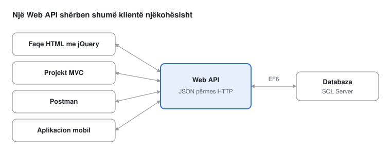

Në këtë ushtrim do ndërtosh një Web API për studentë dhe kurse, dhe do e përdorësh nga dy klientë: një faqe me jQuery dhe një projekt i ri MVC me CRUD të plotë.

## Çfarë do ndërtosh

Në 105 minuta do ndërtosh një sistem të vogël për universitetin: një Web API për studentë dhe kurse (me Entity Framework 6 dhe SQL Server LocalDB), dhe dy klientë që përdorin të njëjtin API. Qëllimi nuk është të kopjosh kod, por të kuptosh si komunikojnë klienti dhe API.

| Pjesa | Tema | Koha |
| --- | --- | --- |
| 1 | Hyrje në Web API dhe krijimi i projektit | 8 min |
| 2 | Modelet (Student, Course, Enrollment) dhe DbContext | 10 min |
| 3 | Migrations dhe të dhënat fillestare | 8 min |
| 4 | Controller-at me CRUD | 17 min |
| 5 | Enrollments dhe testimi me Postman | 7 min |
| 6 | Klienti 1: faqe me jQuery brenda projektit Web API | 15 min |
| 7 | Klienti 2: projekt i ri MVC me CRUD | 25 min |
| 8 | Publikimi në Azure: App Service, Azure SQL dhe publish profile | 15 min |

Secila pjesë ka të njëjtën rrjedhë: teori, një vizatim që e bën të dukshme konceptin, hapat e projektit, një pikë kontrolli dhe pyetje kontrolli. Mos kalo te pjesa tjetër përpara se të kalosh pikën e kontrollit.

### Para se të fillosh

- Visual Studio 2022 me workload-in **ASP.NET and web development** (dhe **Data storage and processing**, që të shohim databazën në SQL Server Object Explorer)
- .NET Framework 4.8 dhe SQL Server LocalDB (instalohen bashkë me Visual Studio)
- Postman (falas, nga postman.com)
- Chrome ose Edge
- Llogari Azure me abonim aktiv (p.sh. Azure for Students ose provë falas), vetëm për Pjesën 8
- Emrat e projekteve, klasave dhe metodave shkruaji saktësisht si në ushtrim, sepse kodi i pjesëve të ardhshme mbështetet mbi këta emra.

## Pjesa 1: Hyrje në Web API dhe krijimi i projektit (8 min)

### Teoria

Web API komunikon përmes HTTP. Çdo kërkesë ka një URL (adresën) dhe një folje HTTP që tregon çfarë veprimi kërkohet. Stili që përdor këto folje mbi burime si studentë dhe kurse quhet REST.

| Veprimi | Folja HTTP | URL shembull | Çfarë kthen |
| --- | --- | --- | --- |
| Lexo të gjithë | GET | `/api/students` | Listë, 200 OK |
| Lexo një | GET | `/api/students/5` | Objekt, 200 ose 404 |
| Shto të ri | POST | `/api/students` | Objekti i krijuar, 201 |
| Ndrysho | PUT | `/api/students/5` | 204 No Content |
| Fshij | DELETE | `/api/students/5` | 200 ose 404 |

Përgjigja ka gjithmonë një kod statusi. Ata që do shohësh më shpesh: 200 OK (u krye), 201 Created (u krijua), 204 No Content (u krye, pa trup përgjigjeje), 400 Bad Request (të dhëna të pavlefshme), 404 Not Found (nuk u gjet) dhe 500 (gabim në server).

Routing-u e lidh URL-në me kodin. Adresa `/api/students/5` mapohet te `StudentsController`, ku `5` bëhet parametri `id`. Rregulli është te `App_Start/WebApiConfig.cs`: `api/{controller}/{id}`. Metoda zgjidhet sipas foljes HTTP: GET thërret metodën `Get`, POST thërret `Post`, PUT thërret `Put`, DELETE thërret `Delete`.

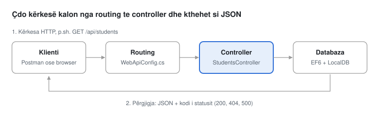

Kjo është rruga e çdo kërkese që do dërgosh gjatë ushtrimit. Kodin e shkruan ti vetëm te controller-i; pjesën tjetër e bën Web API.

### Hapat

**Hapi 1: Krijo projektin**

1. Hap Visual Studio 2022 dhe kliko **Create a new project**.
2. Kërko **ASP.NET Web Application (.NET Framework)** (me ikonën C#) dhe kliko **Next**.
3. Te Project name shkruaj `UniversityApi`. Te Framework zgjidh **.NET Framework 4.8**. Kliko **Create**.

Nëse template-i nuk shfaqet, hap **Visual Studio Installer**, kliko **Modify** dhe shto workload-in **ASP.NET and web development**.

**Hapi 2: Zgjidh template-in Web API**

1. Zgjidh template-in **Web API**.
2. Kliko **Change** nën Authentication dhe zgjidh **No Authentication**.
3. Hiq shenjën te **Configure for HTTPS**, që Postman të mos japë paralajmërime për certifikatën.
4. Kliko **Create**.

**Hapi 3: Njihu me strukturën**

Hap **Solution Explorer** dhe shiko këta skedarë:

| Skedari | Roli |
| --- | --- |
| `App_Start/WebApiConfig.cs` | Konfigurimi i routing-ut të API-së |
| `Controllers/ValuesController.cs` | Controller shembull (trashëgon nga `ApiController`) |
| `Controllers/HomeController.cs` | Controller MVC i zakonshëm (kthen faqe HTML) |
| `Global.asax` | Pika e nisjes së aplikacionit |
| `Web.config` | Konfigurimi, p.sh. connection string |
| `Models/` | Aty do vendosim klasat Student, Course, Enrollment |

**Hapi 4: Nise projektin**

1. Shtyp **F5**. Projekti hapet në browser.
2. Te adresa shto `/api/values`. Do shohësh `value1` dhe `value2`.
3. Në Chrome do e shohësh si XML. Kjo ndodh sepse browser-i e kërkon XML dhe Web API e zgjedh formatin sipas header-it `Accept`. Do e rregullojmë në hapin tjetër.
4. Mbyll browser-in (ose shtyp **Shift+F5**) që ta ndalosh projektin.

**Hapi 5: Kthe vetëm JSON**

Hap `App_Start/WebApiConfig.cs` dhe zëvendësoje metodën `Register` me kodin e mëposhtëm. Shto edhe `using Newtonsoft.Json.Serialization;` lart.

```csharp
public static void Register(HttpConfiguration config)
{
    // Kthe vetëm JSON (hiq formatuesin XML)
    config.Formatters.Remove(config.Formatters.XmlFormatter);

    // Emrat e vetive në JSON fillojnë me shkronjë të vogël: firstName
    config.Formatters.JsonFormatter.SerializerSettings.ContractResolver =
        new CamelCasePropertyNamesContractResolver();

    config.MapHttpAttributeRoutes();

    config.Routes.MapHttpRoute(
        name: "DefaultApi",
        routeTemplate: "api/{controller}/{id}",
        defaults: new { id = RouteParameter.Optional }
    );
}
```

Shtyp **F5** përsëri dhe hap `/api/values`. Tani përgjigja është JSON: `["value1","value2"]`.

**Hapi 6: Fshij ValuesController**

Kliko me të djathtën mbi `ValuesController.cs` në Solution Explorer dhe zgjidh **Delete**. Controller-at tanë do t'i krijojmë në Pjesën 4.

**Hapi 7: Fikso portin e API-së**

Dy klientët që do ndërtojmë më vonë duhet ta dinë adresën e API-së, ndaj portin nuk e lëmë të ndryshojë.

1. Kliko me të djathtën mbi projektin `UniversityApi` dhe zgjidh **Properties**.
2. Hap skedën **Web**.
3. Te **Project Url** shkruaj `http://localhost:5050/` dhe kliko **Create Virtual Directory**.
4. Ruaj me **Ctrl+S** dhe nise projektin me **F5**. Adresa në browser duhet të jetë `http://localhost:5050/`.

Gjatë gjithë ushtrimit adresa bazë e API-së është `http://localhost:5050/api/`. Nëse porti 5050 është i zënë te kompjuteri yt, përdor një tjetër (p.sh. 5060) dhe ndryshoje kudo më vonë.

### Pika e kontrollit

- Projekti `UniversityApi` hapet me F5 te `http://localhost:5050/`.
- Kur e provove, `/api/values` ktheu JSON (pa XML).
- Di ku ndodhet rregulli i routing-ut (`WebApiConfig.cs`).

### Pyetje kontrolli

1. Cila folje HTTP përdoret për të shtuar një student të ri?
2. Çfarë kthen një `ApiController` ndryshe nga një `Controller` në MVC?
3. Cilin kod statusi kthen API kur një student nuk gjendet?

## Pjesa 2: Modelet dhe DbContext (10 min)

### Teoria

**Entity Framework 6 (EF6)** është një ORM: ai lidh klasat e C# me tabelat e databazës. Ti punon me objekte si `Student`, prandaj EF shkruan SQL-në për ty.

Ne përdorim qasjen **Code First**: fillon me klasat dhe EF krijon databazën prej tyre (kjo bëhet në Pjesën 3 me Migrations). EF ndjek disa konvencione: vetia `Id` bëhet çelësi primar, dhe `StudentId` te `Enrollment` bëhet çelës i huaj që tregon te tabela `Students`.

**DbContext** është klasa që përfaqëson databazën. Për çdo tabelë ka një `DbSet<T>`, p.sh. `DbSet<Student> Students`.

**Marrëdhënia shumë-me-shumë.** Një student ndjek shumë kurse, dhe një kurs ka shumë studentë. Databazat e zgjidhin këtë me një tabelë lidhëse. Ne e bëjmë këtë tabelë një klasë më vete, `Enrollment` (regjistrimi), që ka edhe një vlerë të vetën: notar `Grade`. Kjo përbëhet nga dy lidhje një-me-shumë: Student → Enrollment dhe Course → Enrollment.

**Navigation properties** (p.sh. `Student.Enrollments`) i lejojnë kodit të ecë nga një objekt te objektet e lidhura. Ato nuk bëhen kolona në tabelë.

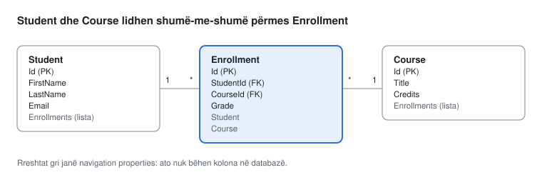

Shiko vizatimin: `Enrollment` është ura mes `Student` dhe `Course`. Është e vetmja klasë me dy çelësa të huaj.

### Hapat

**Hapi 1: Instalo Entity Framework 6**

1. Hap **Tools → NuGet Package Manager → Package Manager Console**.
2. Shkruaj dhe shtyp Enter:

```
Install-Package EntityFramework
```

Pas instalimit, `Web.config` merr një seksion `<entityFramework>` që përdor `mssqllocaldb` si lidhje të paracaktuar.

**Hapi 2: Krijo klasat e modelit**

Kliko me të djathtën mbi folderin `Models` → **Add → Class** dhe krijo tri skedarë.

`Models/Student.cs`:

```csharp
using System.Collections.Generic;
using System.ComponentModel.DataAnnotations;
using Newtonsoft.Json;

namespace UniversityApi.Models
{
    public class Student
    {
        public int Id { get; set; }

        [Required, StringLength(50)]
        public string FirstName { get; set; }

        [Required, StringLength(50)]
        public string LastName { get; set; }

        [Required, EmailAddress, StringLength(100)]
        public string Email { get; set; }

        [JsonIgnore]
        public ICollection<Enrollment> Enrollments { get; set; }
    }
}
```

`Models/Course.cs`:

```csharp
using System.Collections.Generic;
using System.ComponentModel.DataAnnotations;
using Newtonsoft.Json;

namespace UniversityApi.Models
{
    public class Course
    {
        public int Id { get; set; }

        [Required, StringLength(100)]
        public string Title { get; set; }

        [Range(1, 30)]
        public int Credits { get; set; }

        [JsonIgnore]
        public ICollection<Enrollment> Enrollments { get; set; }
    }
}
```

`Models/Enrollment.cs`:

```csharp
using System.ComponentModel.DataAnnotations;
using Newtonsoft.Json;

namespace UniversityApi.Models
{
    public class Enrollment
    {
        public int Id { get; set; }
        public int StudentId { get; set; }
        public int CourseId { get; set; }

        [Range(5, 10)]
        public int? Grade { get; set; }

        [JsonIgnore]
        public Student Student { get; set; }

        [JsonIgnore]
        public Course Course { get; set; }
    }
}
```

Pse `[JsonIgnore]`? Pa të, JSON-i do të provonte të serializonte Student → Enrollments → Student → Enrollments... në një ciklë të pafund dhe do jepte gabim. `Grade` është `int?` sepse nota mund të mos jetë dhënë ende.

**Hapi 3: Krijo DbContext**

`Models/UniversityContext.cs`:

```csharp
using System.Data.Entity;

namespace UniversityApi.Models
{
    public class UniversityContext : DbContext
    {
        public UniversityContext() : base("name=UniversityContext")
        {
        }

        public DbSet<Student> Students { get; set; }
        public DbSet<Course> Courses { get; set; }
        public DbSet<Enrollment> Enrollments { get; set; }
    }
}
```

**Hapi 4: Shto connection string**

Hap `Web.config` (të projekti `UniversityApi`) dhe shto këtë bllok brenda `<configuration>`, menjëherë pas `</configSections>`:

```xml
<connectionStrings>
  <add name="UniversityContext"
       connectionString="Data Source=(localdb)\MSSQLLocalDB;Initial Catalog=UniversityDb;Integrated Security=True;MultipleActiveResultSets=True"
       providerName="System.Data.SqlClient" />
</connectionStrings>
```

Kuptimi: `Data Source` është instanca LocalDB, `Initial Catalog` është emri i databazës që do krijohet (`UniversityDb`), dhe `Integrated Security=True` përdor llogarinë tuaj të Windows. Emri `UniversityContext` duhet të jetë i njëjtë me atë te `base("name=UniversityContext")`.

**Hapi 5: Kompilo projektin**

Shtyp **Ctrl+Shift+B**. Te Output duhet të shohësh `Build succeeded`.

### Pika e kontrollit

- Projekti kompilohet pa gabime.
- Ke 4 klasa te folderi `Models`: `Student`, `Course`, `Enrollment`, `UniversityContext`.
- Emri i connection string (`UniversityContext`) përputhet me `base("name=UniversityContext")`.

### Pyetje kontrolli

1. Pse `Enrollment` është klasë më vete dhe jo vetëm një lidhje automatike mes Student dhe Course?
2. Çfarë përfaqëson `DbSet<Student>` në databazë?
3. Cilat dy veti te `Enrollment` bëhen çelësa të huaj sipas konvencionit të EF?

## Pjesa 3: Migrations dhe të dhënat fillestare (8 min)

### Teoria

Kur ndryshon një klasë (p.sh. shton `Phone` te `Student`), databaza duhet të përditësohet pa i humbur të dhënat ekzistuese. **Migrations** e zgjidh këtë: çdo ndryshim ruhet si skedar C# në folderin `Migrations`, dhe mund të zbatohet në çdo databazë.

Punën e bëjnë tri komanda në Package Manager Console:

| Komanda | Çfarë bën | Sa herë |
| --- | --- | --- |
| `Enable-Migrations` | Krijon folderin `Migrations` dhe `Configuration.cs` | Një herë |
| `Add-Migration <Emri>` | Krahason klasat me databazën dhe krijon skedarin e migrimit | Çdo ndryshim |
| `Update-Database` | Zbaton migrimet në databazë dhe nis `Seed` | Pas çdo migrimi |

Metoda `Seed` ngarkon të dhëna fillestare, që të kemi çfarë të shohim në API pa i shtuar me dorë. Përdorim `AddOrUpdate`, që nuk krijon dublikate kur komanda ekzekutohet përsëri. EF mban shënim te tabela `__MigrationHistory` cilat migrime u zbatuan tashmë.

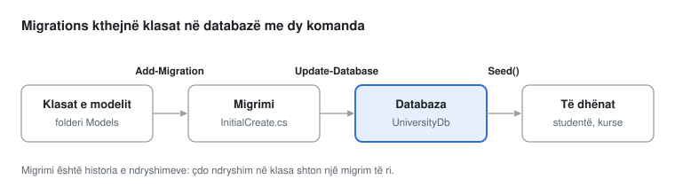

Shiko vizatimin: ti shkruan klasat dhe komandat, EF bën pjesën tjetër.

### Hapat

**Hapi 1: Aktivizo Migrations**

Hap **Tools → NuGet Package Manager → Package Manager Console**. Sigurohu që te **Default project** është zgjedhur `UniversityApi`, pastaj shkruaj:

```
Enable-Migrations
```

Te Solution Explorer shfaqet folderi `Migrations` me skedarin `Configuration.cs`.

**Hapi 2: Krijo migrimin e parë**

```
Add-Migration InitialCreate
```

Hap skedarin e ri `Migrations/..._InitialCreate.cs`. Do shohësh `CreateTable` për `Students`, `Courses` dhe `Enrollments`, dhe `ForeignKey` te `Enrollments`. Kjo është struktura që do të krijohet në databazë.

**Hapi 3: Shto të dhënat fillestare**

Hap `Migrations/Configuration.cs` dhe zëvendëso gjithçka me këtë kod:

```csharp
using System.Data.Entity.Migrations;
using System.Linq;
using UniversityApi.Models;

namespace UniversityApi.Migrations
{
    internal sealed class Configuration : DbMigrationsConfiguration<UniversityContext>
    {
        public Configuration()
        {
            AutomaticMigrationsEnabled = false;
        }

        protected override void Seed(UniversityContext context)
        {
            context.Students.AddOrUpdate(s => s.Email,
                new Student { FirstName = "Arben", LastName = "Krasniqi", Email = "arben.krasniqi@example.com" },
                new Student { FirstName = "Elira", LastName = "Berisha", Email = "elira.berisha@example.com" },
                new Student { FirstName = "Dren", LastName = "Ahmeti", Email = "dren.ahmeti@example.com" });

            context.Courses.AddOrUpdate(c => c.Title,
                new Course { Title = "ASP.NET MVC", Credits = 6 },
                new Course { Title = "Baza e të dhënave", Credits = 5 },
                new Course { Title = "Programim vizual", Credits = 6 });

            // Ruaj, që studentët dhe kurset të marrin Id para se të lidhen
            context.SaveChanges();

            var arben = context.Students.First(s => s.Email == "arben.krasniqi@example.com");
            var elira = context.Students.First(s => s.Email == "elira.berisha@example.com");
            var mvc = context.Courses.First(c => c.Title == "ASP.NET MVC");
            var dbCourse = context.Courses.First(c => c.Title == "Baza e të dhënave");

            context.Enrollments.AddOrUpdate(e => new { e.StudentId, e.CourseId },
                new Enrollment { StudentId = arben.Id, CourseId = mvc.Id, Grade = 9 },
                new Enrollment { StudentId = arben.Id, CourseId = dbCourse.Id },
                new Enrollment { StudentId = elira.Id, CourseId = mvc.Id, Grade = 10 });

            context.SaveChanges();
        }
    }
}
```

**Hapi 4: Krijo databazën**

```
Update-Database
```

Në konsolë shfaqen mesazhet `Applying explicit migrations: [..._InitialCreate]` dhe `Running Seed method`. Njëkohësisht EF krijon databazën `UniversityDb` në LocalDB.

**Hapi 5: Shiko databazën**

1. Hap **View → SQL Server Object Explorer**.
2. Zgjero **SQL Server → (localdb)\MSSQLLocalDB → Databases → UniversityDb → Tables**. Nëse nuk e sheh `(localdb)\MSSQLLocalDB`, kliko **Add SQL Server**, zgjidh skedën **Local** dhe zgjidh `MSSQLLocalDB`.
3. Kliko me të djathtën mbi `dbo.Students` dhe zgjidh **View Data**. Duhet të shohësh 3 studentë.
4. Bëj të njëjtën për `dbo.Courses` dhe `dbo.Enrollments`.

### Pika e kontrollit

- Databaza `UniversityDb` ka tabelat `Students`, `Courses`, `Enrollments` dhe `__MigrationHistory`.
- `Students` ka 3 rreshta, `Courses` ka 3 rreshta, `Enrollments` ka 3 rreshta.

### Pyetje kontrolli

1. Cila komandë krijon skedarin e migrimit dhe cila e zbaton në databazë?
2. Pse përdorim `AddOrUpdate` në vend të `Add` te metoda `Seed`?
3. Ku e di EF cilat migrime janë zbatuar tashmë?

## Pjesa 4: Controller-at me CRUD (17 min)

### Teoria

**Controller-i** merr kërkesat dhe kthen përgjigjet. Emri i klasës përcakton URL-në: `StudentsController` përgjigjet te `/api/students`.

**CRUD** do të thotë Create, Read, Update, Delete: katër veprimet bazë mbi të dhënat. Në Web API ato përputhen me foljet POST, GET, PUT dhe DELETE. Web API e zgjedh metodën sipas fillimit të emrit: metoda që fillon me `Get` përgjigjet për GET, `Post` për POST, `Put` për PUT, `Delete` për DELETE. Dy metodat GET dallohen nga parametri: ajo me `id` lexon një student, tjetra lexon të gjithë.

**IHttpActionResult** është tipi që përfaqëson përgjigjen HTTP. Metodat ndihmëse ia vendosin kodin e statusit: `Ok(student)` kthen 200, `NotFound()` kthen 404, `BadRequest(...)` kthen 400, `CreatedAtRoute(...)` kthen 201, `StatusCode(HttpStatusCode.NoContent)` kthen 204.

**Parametrat.** `id` merret nga URL-ja. Objekti `Student` merret nga trupi i kërkesës: klienti dërgon JSON dhe Web API e kthen automatikisht në objekt C# (model binding). `ModelState.IsValid` kontrollon rregullat si `[Required]` dhe `[StringLength]` që shkruam te modeli.

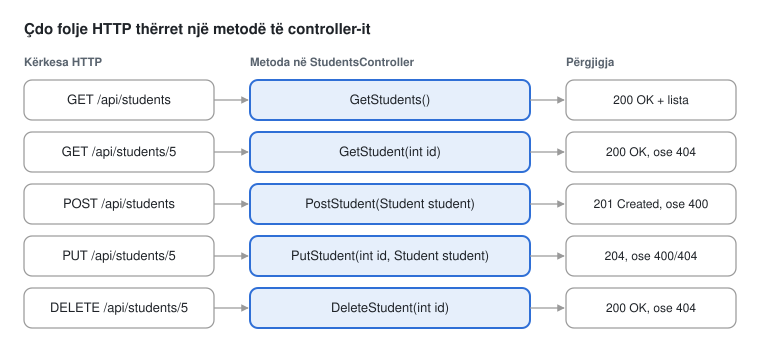

Shiko vizatimin: pesë veprimet CRUD, pesë metoda, pesë përgjigje. Controller-i i kurseve do ketë të njëjtën formë.

### Hapat

**Hapi 1: Kompilo projektin**

Shtyp **Ctrl+Shift+B**. Scaffolding punon vetëm nëse projekti kompilohet pa gabime.

**Hapi 2: Krijo StudentsController me scaffolding**

1. Kliko me të djathtën mbi folderin `Controllers` → **Add → Controller...**
2. Zgjidh **Web API 2 Controller with actions, using Entity Framework** dhe kliko **Add**.
3. Te **Model class** zgjidh `Student (UniversityApi.Models)`.
4. Te **Data context class** zgjidh `UniversityContext (UniversityApi.Models)`.
5. Lëre **pa shenjë** opsionin *Use async controller actions*.
6. Te **Controller name** shkruaj `StudentsController` dhe kliko **Add**.

Nëse nuk e ke këtë opsion, zgjidh **Web API 2 Controller - Empty**, quaje `StudentsController` dhe shkruaj kodin e mëposhtëm vetë.

**Hapi 3: Lexo kodin që u gjenerua**

Ky është kodi i plotë. Lexoje metodë pas metode dhe lidhi me vizatimin.

```csharp
using System.Data.Entity;
using System.Data.Entity.Infrastructure;
using System.Linq;
using System.Net;
using System.Web.Http;
using System.Web.Http.Description;
using UniversityApi.Models;

namespace UniversityApi.Controllers
{
    public class StudentsController : ApiController
    {
        private UniversityContext db = new UniversityContext();

        // GET: api/Students
        public IQueryable<Student> GetStudents()
        {
            return db.Students;
        }

        // GET: api/Students/5
        [ResponseType(typeof(Student))]
        public IHttpActionResult GetStudent(int id)
        {
            Student student = db.Students.Find(id);
            if (student == null)
            {
                return NotFound();
            }

            return Ok(student);
        }

        // PUT: api/Students/5
        [ResponseType(typeof(void))]
        public IHttpActionResult PutStudent(int id, Student student)
        {
            if (!ModelState.IsValid)
            {
                return BadRequest(ModelState);
            }

            if (id != student.Id)
            {
                return BadRequest();
            }

            db.Entry(student).State = EntityState.Modified;

            try
            {
                db.SaveChanges();
            }
            catch (DbUpdateConcurrencyException)
            {
                if (!StudentExists(id))
                {
                    return NotFound();
                }
                else
                {
                    throw;
                }
            }

            return StatusCode(HttpStatusCode.NoContent);
        }

        // POST: api/Students
        [ResponseType(typeof(Student))]
        public IHttpActionResult PostStudent(Student student)
        {
            if (!ModelState.IsValid)
            {
                return BadRequest(ModelState);
            }

            db.Students.Add(student);
            db.SaveChanges();

            return CreatedAtRoute("DefaultApi", new { id = student.Id }, student);
        }

        // DELETE: api/Students/5
        [ResponseType(typeof(Student))]
        public IHttpActionResult DeleteStudent(int id)
        {
            Student student = db.Students.Find(id);
            if (student == null)
            {
                return NotFound();
            }

            db.Students.Remove(student);
            db.SaveChanges();

            return Ok(student);
        }

        protected override void Dispose(bool disposing)
        {
            if (disposing)
            {
                db.Dispose();
            }
            base.Dispose(disposing);
        }

        private bool StudentExists(int id)
        {
            return db.Students.Count(e => e.Id == id) > 0;
        }
    }
}
```

Kuptimi i pjesëve kryesore:

| Rreshti | Çfarë bën |
| --- | --- |
| `private UniversityContext db = new UniversityContext();` | Hap lidhjen me databazën për këtë controller |
| `db.Students.Find(id)` | Kërkon student sipas çelësit primar; kthen `null` nëse nuk ekziston |
| `ModelState.IsValid` | Kontrollon rregullat e validimit të modelit (`[Required]`, etj.) |
| `db.Entry(student).State = EntityState.Modified` | I thotë EF që ky student ekziston dhe duhet të përditësohet |
| `db.Students.Add(student)` dhe `db.SaveChanges()` | Shton objektin dhe e ruan në databazë; pa `SaveChanges` asgjë nuk shkon në databazë |
| `CreatedAtRoute(...)` | Kthen 201 dhe adresën e studentit të ri te header-i `Location` |
| `Dispose` | Mbyll lidhjen me databazën kur controller-i përfundon |

**Hapi 4: Testo në browser**

1. Shtyp **F5**.
2. Hap `http://localhost:5050/api/students`. Duhet të shohësh JSON me 3 studentë.
3. Hap `http://localhost:5050/api/students/1`. Duhet të shohësh vetëm një student.
4. Hap `http://localhost:5050/api/students/99`. Student me këtë Id nuk ekziston, ndaj përgjigja është 404.

Browser-i dërgon vetëm GET. Për POST, PUT dhe DELETE do përdorim Postman në Pjesën 5.

**Hapi 5: Ushtrim i pavarur, krijo CoursesController**

Përsërit Hapin 2 por me **Model class** `Course` dhe **Controller name** `CoursesController`. Pastaj hap `http://localhost:5050/api/courses`. Duhet të shohësh 3 kurse.

Përgjigja e `/api/students` në browser:

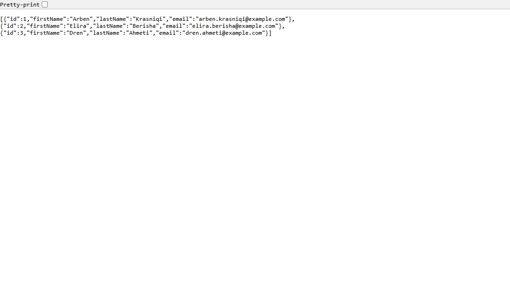

### Pika e kontrollit

- `/api/students` kthen 3 studentë në JSON.
- `/api/students/1` kthen një student dhe `/api/students/99` kthen 404.
- `/api/courses` kthen 3 kurse në JSON.

### Pyetje kontrolli

1. Si e dallon Web API metodën `GetStudents()` nga `GetStudent(int id)`?
2. Pse thirret `db.SaveChanges()` pas `db.Students.Add(student)`?
3. Cilin kod statusi kthen `CreatedAtRoute` dhe cilin `NotFound`?

## Pjesa 5: Enrollments dhe testimi me Postman (7 min)

### Teoria

**Postman** është një mjet që dërgon kërkesa HTTP pa shkruar klient. Browser-i dërgon vetëm GET kur hap një adresë, ndaj për POST, PUT dhe DELETE na duhet Postman.

Një kërkesë ka katër pjesë: **foljën** (GET, POST...), **URL-në**, **header-at** dhe **trupin** (body). Kur dërgon JSON, header-i `Content-Type: application/json` i tregon API-së që trupi është JSON. Përgjigja ka **kodin e statusit**, header-at dhe trupin. Te testimi, gjithmonë kontrolloje fillimisht kodin e statusit.

**DTO** (Data Transfer Object) është një klasë që përmban saktësisht të dhënat që dërgojmë te klienti. Te `Enrollment` kemi `[JsonIgnore]` mbi `Student` dhe `Course`, ndaj përgjigjja do të kishte vetëm numrat `StudentId` dhe `CourseId`. Ne duam edhe emrin e studentit dhe titullin e kursit, prandaj përdorim `EnrollmentDto`. LINQ `Select` e mbush këtë klasë direkt nga databaza.

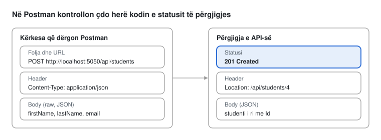

Shiko vizatimin: ti dërgon kërkesën e majtë, API kthen përgjigjen e djathtë, dhe nga përgjigja lexon së pari kodin e statusit.

### Hapat

**Hapi 1: Krijo EnrollmentDto**

`Models/EnrollmentDto.cs`:

```csharp
namespace UniversityApi.Models
{
    public class EnrollmentDto
    {
        public int Id { get; set; }
        public int StudentId { get; set; }
        public string StudentName { get; set; }
        public int CourseId { get; set; }
        public string CourseTitle { get; set; }
        public int? Grade { get; set; }
    }
}
```

**Hapi 2: Krijo EnrollmentsController**

Kliko me të djathtën mbi `Controllers` → **Add → Controller...** → **Web API 2 Controller - Empty** → emri `EnrollmentsController`. Zëvendëso kodin me këtë:

```csharp
using System;
using System.Linq;
using System.Linq.Expressions;
using System.Web.Http;
using System.Web.Http.Description;
using UniversityApi.Models;

namespace UniversityApi.Controllers
{
    public class EnrollmentsController : ApiController
    {
        private UniversityContext db = new UniversityContext();

        // Si kthehet një Enrollment në EnrollmentDto (përdoret në disa vende)
        private static readonly Expression<Func<Enrollment, EnrollmentDto>> AsDto =
            e => new EnrollmentDto
            {
                Id = e.Id,
                StudentId = e.StudentId,
                StudentName = e.Student.FirstName + " " + e.Student.LastName,
                CourseId = e.CourseId,
                CourseTitle = e.Course.Title,
                Grade = e.Grade
            };

        // GET: api/Enrollments
        public IQueryable<EnrollmentDto> GetEnrollments()
        {
            return db.Enrollments.Select(AsDto);
        }

        // GET: api/Enrollments/5
        [ResponseType(typeof(EnrollmentDto))]
        public IHttpActionResult GetEnrollment(int id)
        {
            var enrollment = db.Enrollments.Where(e => e.Id == id).Select(AsDto).FirstOrDefault();
            if (enrollment == null)
            {
                return NotFound();
            }

            return Ok(enrollment);
        }

        // POST: api/Enrollments
        [ResponseType(typeof(EnrollmentDto))]
        public IHttpActionResult PostEnrollment(Enrollment enrollment)
        {
            if (!ModelState.IsValid)
            {
                return BadRequest(ModelState);
            }

            if (!db.Students.Any(s => s.Id == enrollment.StudentId) ||
                !db.Courses.Any(c => c.Id == enrollment.CourseId))
            {
                return BadRequest("Studenti ose kursi nuk ekziston.");
            }

            if (db.Enrollments.Any(e => e.StudentId == enrollment.StudentId && e.CourseId == enrollment.CourseId))
            {
                return Conflict();
            }

            db.Enrollments.Add(enrollment);
            db.SaveChanges();

            var dto = db.Enrollments.Where(e => e.Id == enrollment.Id).Select(AsDto).First();
            return CreatedAtRoute("DefaultApi", new { id = dto.Id }, dto);
        }

        // DELETE: api/Enrollments/5
        public IHttpActionResult DeleteEnrollment(int id)
        {
            var enrollment = db.Enrollments.Find(id);
            if (enrollment == null)
            {
                return NotFound();
            }

            db.Enrollments.Remove(enrollment);
            db.SaveChanges();

            return Ok();
        }

        protected override void Dispose(bool disposing)
        {
            if (disposing)
            {
                db.Dispose();
            }
            base.Dispose(disposing);
        }
    }
}
```

Vëre re dy rregulla të reja: `Conflict()` kthen 409 kur një student është tashmë i regjistruar te ky kurs, dhe `BadRequest("...")` kthen 400 kur Id-të nuk ekzistojnë.

**Hapi 3: Nise API-në**

Shtyp **Ctrl+F5** (nis pa debugger, që API të mbetet i hapur). Hap `http://localhost:5050/api/enrollments`. Duhet të shohësh 3 regjistrime me emrat e studentëve dhe titujt e kurseve.

**Hapi 4: Instalo dhe hap Postman**

1. Shkarko Postman nga postman.com dhe instaloje.
2. Kliko **New → HTTP** (ose **+** për një tab të ri).
3. Zgjidh foljën **GET**, shkruaj `http://localhost:5050/api/students` dhe kliko **Send**.
4. Në pjesën e poshtme shiko statusin (`200 OK`) dhe JSON-in me studentët.

**Hapi 5: Testo CRUD me Postman**

Për POST dhe PUT: zgjidh skedën **Body**, zgjidh **raw** dhe në listën e djathtë zgjidh **JSON**. Postman e shton vetë header-in `Content-Type`. Ekzekuto testet në këtë radhë dhe krahaso statusin:

| # | Folja dhe URL | Body | Pritet |
| --- | --- | --- | --- |
| 1 | GET `/api/students/1` | (bosh) | 200 OK |
| 2 | GET `/api/students/99` | (bosh) | 404 Not Found |
| 3 | POST `/api/students` | `{"firstName":"Lira","lastName":"Gashi","email":"lira.gashi@example.com"}` | 201 Created, studenti i ri me një Id (p.sh. 4) |
| 4 | POST `/api/students` | `{"firstName":"Lira","lastName":"Gashi"}` | 400 Bad Request (mungon email) |
| 5 | PUT `/api/students/4` | `{"id":4,"firstName":"Lira","lastName":"Gashi-Ahmeti","email":"lira.gashi@example.com"}` | 204 No Content |
| 6 | GET `/api/students/4` | (bosh) | 200 OK, mbiemri i ndryshuar |
| 7 | DELETE `/api/students/4` | (bosh) | 200 OK |
| 8 | GET `/api/students/4` | (bosh) | 404 Not Found |
| 9 | POST `/api/enrollments` | `{"studentId":3,"courseId":1,"grade":8}` | 201 Created |
| 10 | POST `/api/enrollments` (e njëjta) | `{"studentId":3,"courseId":1,"grade":8}` | 409 Conflict |

Në testin 5 përdor Id-në që të ktheu testi 3 (nëse nuk është 4, ndryshoje në URL dhe në body).

Përgjigja e `/api/enrollments` në browser:

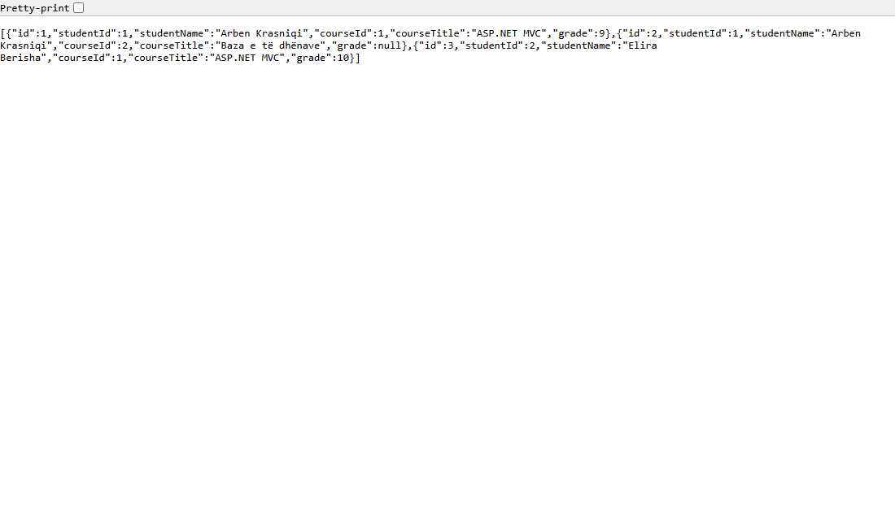

### Pika e kontrollit

- Të 10 testet kthejnë statusin e pritur.
- `/api/enrollments` shfaq emrat e studentëve dhe titujt e kurseve, jo vetëm numrat.
- API-ja mbetet e hapur (nisur me Ctrl+F5) për pjesët e ardhshme.

### Pyetje kontrolli

1. Pse na duhet Postman dhe nuk mjafton browser-i?
2. Çfarë i thotë header-i `Content-Type: application/json` API-së?
3. Pse `EnrollmentsController` kthen `EnrollmentDto` dhe jo vetë `Enrollment`?

## Pjesa 6: Klienti 1, faqe me jQuery brenda projektit Web API (15 min)

### Teoria

**AJAX** është teknika ku JavaScript dërgon kërkesë HTTP në prapaskenë dhe përditëson vetëm një pjesë të faqes, pa e rifreskuar të gjithë faqen. **jQuery** e bën të lehtë me metoda si `$.getJSON` dhe `$.ajax`.

Rrjedha ka dy hapa. Së pari, browser-i kërkon faqen `/Home/Students`; MVC kthen HTML me JavaScript brenda. Së dyti, JavaScript-i i faqes thërret `/api/students`, merr JSON dhe ndërton rreshtat e tabelës.

**Same-origin policy.** Browser-i lejon JavaScript-in të thërrasë lirisht vetëm adresën nga e cila u ngarkua faqja (protokolli, hosti dhe porti duhet të jenë të njëjtë). Faqja jonë dhe API-ja janë të dyja te `localhost:5050`, ndaj gjithçka punon pa konfigurim. Nëse faqja do të ishte diku tjetër (p.sh. një skedar në Desktop), browser-i do e bllokonte, dhe API-ja do duhej ta lejonte eksplicitisht me **CORS**. Kjo shihet te ushtrimi shtesë në fund të kësaj pjese.

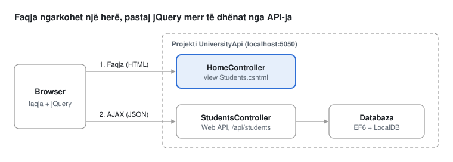

Shiko vizatimin: ky projekt është njëkohësisht server faqesh (MVC) dhe server të dhënash (Web API). Faqja (shigjeta 1) vjen nga `HomeController`, të dhënat (shigjeta 2) vijnë nga `StudentsController`.

### Hapat

**Hapi 1: Shto veprimin Students te HomeController**

Hap `Controllers/HomeController.cs` dhe shto këtë metodë brenda klasës:

```csharp
public ActionResult Students()
{
    return View();
}
```

**Hapi 2: Krijo view-n**

1. Kliko me të djathtën brenda metodës `Students()` dhe zgjidh **Add View...**
2. Zgjidh **MVC 5 View** dhe kliko **Add**.
3. Te **View name** shkruaj `Students`, te **Template** zgjidh **Empty (without model)**, lëre të shenjuar **Use a layout page** dhe kliko **Add**.

**Hapi 3: Shkruaj faqen dhe kodin jQuery**

Hap `Views/Home/Students.cshtml` dhe zëvendëso gjithçka me:

```html
@{
    ViewBag.Title = "Studentët (jQuery)";
}

<h2>Studentët (jQuery + Web API)</h2>

<div class="row" style="margin-bottom: 16px;">
    <div class="col-md-3"><input id="firstName" class="form-control" placeholder="Emri" /></div>
    <div class="col-md-3"><input id="lastName" class="form-control" placeholder="Mbiemri" /></div>
    <div class="col-md-4"><input id="email" class="form-control" placeholder="Email" /></div>
    <div class="col-md-2"><button id="btnAdd" class="btn btn-primary">Shto</button></div>
</div>

<p id="message" class="text-danger"></p>

<table class="table table-striped">
    <thead>
        <tr><th>Id</th><th>Emri</th><th>Mbiemri</th><th>Email</th><th></th></tr>
    </thead>
    <tbody id="studentsBody"></tbody>
</table>

@section scripts {
    <script>
        var apiUrl = "/api/students";

        // GET: lexo studentët dhe mbush tabelën
        function loadStudents() {
            $.getJSON(apiUrl)
                .done(function (students) {
                    var body = $("#studentsBody").empty();
                    $.each(students, function (i, s) {
                        var row = $("<tr>");
                        row.append($("<td>").text(s.id));
                        row.append($("<td>").text(s.firstName));
                        row.append($("<td>").text(s.lastName));
                        row.append($("<td>").text(s.email));
                        var btn = $("<button>").addClass("btn btn-danger btn-sm btn-delete")
                                               .attr("data-id", s.id).text("Fshij");
                        row.append($("<td>").append(btn));
                        body.append(row);
                    });
                })
                .fail(function () {
                    $("#message").text("Gabim gjatë leximit të studentëve.");
                });
        }

        // POST: shto student të ri
        $("#btnAdd").click(function () {
            var student = {
                firstName: $("#firstName").val(),
                lastName: $("#lastName").val(),
                email: $("#email").val()
            };

            $.ajax({
                url: apiUrl,
                type: "POST",
                contentType: "application/json",
                data: JSON.stringify(student)
            })
            .done(function () {
                $("#message").text("");
                $("#firstName, #lastName, #email").val("");
                loadStudents();
            })
            .fail(function (xhr) {
                $("#message").text("Studenti nuk u ruajt (status " + xhr.status + "). Kontrollo fushat.");
            });
        });

        // DELETE: fshij student
        $("#studentsBody").on("click", ".btn-delete", function () {
            var id = $(this).data("id");
            $.ajax({ url: apiUrl + "/" + id, type: "DELETE" })
                .done(loadStudents);
        });

        // Kur faqja ngarkohet, lexo studentët
        $(function () {
            loadStudents();
        });
    </script>
}
```

Shikoji tri gjëra te kodi. Së pari, URL-ja është relative (`/api/students`), pa port. Së dyti, `$.getJSON` dërgon GET, ndërsa `$.ajax` me `type: "POST"` dhe `type: "DELETE"` dërgon foljet e tjera. Së treti, përdorim `.text()` dhe jo `.html()`, që të dhënat e shkruara nga përdoruesi të trajtohen si tekst dhe jo si kod HTML (mbrojtje nga XSS).

**Hapi 4: Shto lidhje te menyja**

Hap `Views/Shared/_Layout.cshtml`, gjej listën `<ul class="nav navbar-nav">` dhe shto brenda saj:

```html
<li>@Html.ActionLink("Studentët", "Students", "Home")</li>
```

**Hapi 5: Nise dhe provo**

1. Shtyp **Ctrl+F5** dhe hap `http://localhost:5050/Home/Students` (ose kliko lidhjen te menyja).
2. Duhet të shohësh tabelën me studentët nga databaza.
3. Shto një student të ri me butonin **Shto**. Shfaqet menjëherë në tabelë.
4. Fshij një student me butonin **Fshij**.
5. Provo të shtosh student pa email. Duhet të shohësh mesazhin e gabimit (status 400).

**Hapi 6: Shiko komunikimin HTTP**

Shtyp **F12** në browser, hap skedën **Network** dhe zgjidh filtrin **Fetch/XHR**. Rifresko faqen dhe shto një student. Do shohësh kërkesat `students` me foljet GET dhe POST dhe kodet e statusit (200, 201). Kliko mbi një kërkesë dhe shiko **Headers** dhe **Response**: është e njëjta gjë që pe te Postman.

**Ushtrim shtesë (opsional): faqe HTML në Desktop dhe CORS**

1. Krijo skedarin `students.html` në Desktop me këtë përmbajtje:

```html
<!DOCTYPE html>
<html lang="sq">
<head>
    <meta charset="utf-8" />
    <title>Studentët (Desktop)</title>
    <script src="https://code.jquery.com/jquery-3.7.1.min.js"></script>
</head>
<body>
    <h2>Studentët nga skedari në Desktop</h2>
    <ul id="list"></ul>
    <script>
        $.getJSON("http://localhost:5050/api/students", function (students) {
            $.each(students, function (i, s) {
                $("#list").append($("<li>").text(s.firstName + " " + s.lastName));
            });
        });
    </script>
</body>
</html>
```

2. Hape me dy klikime (API-ja duhet të jetë e nisur). Lista mbetet bosh. Shtyp **F12 → Console**: do shohësh një gabim që përmend **CORS policy**. Browser-i e bllokoi kërkesën sepse faqja (`file://`) dhe API-ja janë origjina të ndryshme.
3. Ndalo API-në dhe instalo paketën në Package Manager Console:

```
Install-Package Microsoft.AspNet.WebApi.Cors
```

4. Te `WebApiConfig.cs` shto `using System.Web.Http.Cors;` lart dhe këtë rresht si rreshti i parë brenda `Register`:

```csharp
config.EnableCors(new EnableCorsAttribute("*", "*", "*"));
```

5. Nise API-në përsëri me Ctrl+F5 dhe rifresko `students.html`. Tani lista shfaqet.

Shënim: `"*"` lejon çdo origjinë. Për trajnim është në rregull, por në një sistem real lejohen vetëm adresat e njohura të klientëve.

Faqja jQuery duhet të duket kështu:

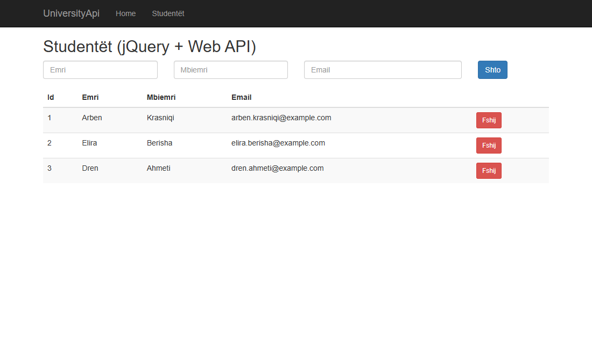

### Pika e kontrollit

- `/Home/Students` shfaq studentët nga API-ja.
- Shtimi dhe fshirja e një studenti punon pa rifreskuar faqen.
- Te skeda Network sheh kërkesat GET, POST dhe DELETE.

### Pyetje kontrolli

1. Çfarë është AJAX dhe çfarë e bën ndryshe nga një faqe e zakonshme?
2. Pse `/api/students` (pa `http://localhost:5050`) punon brenda kësaj faqeje?
3. Pse përdorim `.text()` dhe jo `.html()` kur shfaqim të dhënat e studentit?
4. Cilën folje HTTP dërgon butoni **Fshij**?

## Pjesa 7: Klienti 2, projekt i ri MVC me CRUD (25 min)

### Teoria

Tani do ndërtosh një aplikacion MVC të zakonshëm që **nuk ka databazë të vetën**. Të gjitha të dhënat i merr dhe i ruan përmes Web API-së që ndërtove në Pjesët 1 deri 5.

Ky është ndryshimi nga Pjesa 6. Atje JavaScript-i në browser e thërriste API-në. Këtu browser-i nuk e di fare që ekziston API: ai flet vetëm me projektin MVC, prandaj **serveri MVC** e thërret API-në nga kodi C#. Rrjedhimisht, kjo thirrje ndodh server-me-server dhe nuk ka nevojë për CORS.

Për të thërritur API-në nga C# përdorim klasën **HttpClient** (`System.Net.Http`). Foljet HTTP përputhen me metodat e saj: `GetAsync`, `PostAsync`, `PutAsync`, `DeleteAsync`. Përgjigja vjen si tekst JSON dhe me Newtonsoft.Json e kthejmë në objekte C#. Thirrjet e rrjetit zgjasin, ndaj përdorim `async` dhe `await`: kodi pret përgjigjen pa e bllokuar serverin.

Klasat `Student` dhe `Course` te projekti MVC janë kopje të formës së të dhënave që kthen API (kontrata mes tyre). Një `HttpClient` i vetëm përdoret për gjithë aplikacionin (`static`), sepse krijimi i tij sa herë është i kushtueshëm dhe mund të shterë portat e serverit.

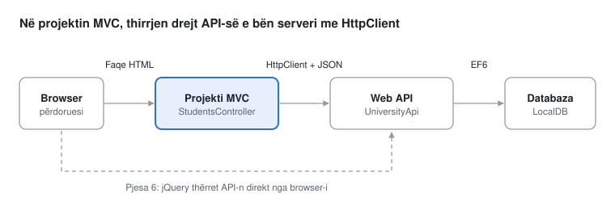

Shiko vizatimin: shigjetat e plota janë rruga e Pjesës 7. Vija e ndarë tregon rrugën e Pjesës 6, ku browser-i e thërriste API-në direkt.

### Hapat

**Hapi 1: Sigurohu që API-ja është e nisur**

Në Visual Studio e parë (projekti `UniversityApi`) shtyp **Ctrl+F5**. Hap `http://localhost:5050/api/students` në browser: duhet të shohësh studentët. Mos e mbyll këtë dritare gjatë gjithë pjesës.

**Hapi 2: Krijo projektin e ri MVC**

1. Hap një **Visual Studio të dytë** (nga menyja Start e Windows).
2. **Create a new project** → **ASP.NET Web Application (.NET Framework)** → **Next**.
3. Project name: `UniversityMvcClient`, Framework: **.NET Framework 4.8** → **Create**.
4. Zgjidh template-in **MVC**, **Authentication: No Authentication**, hiq shenjën te **Configure for HTTPS** → **Create**.
5. Kliko me të djathtën mbi projektin → **Properties → Web** → te **Project Url** shkruaj `http://localhost:5051/` → **Create Virtual Directory** → **Ctrl+S**.

**Hapi 3: Krijo klasat e modelit**

Te folderi `Models` shto dy klasa.

`Models/Student.cs`:

```csharp
using System.ComponentModel.DataAnnotations;

namespace UniversityMvcClient.Models
{
    public class Student
    {
        public int Id { get; set; }

        [Required(ErrorMessage = "Emri është i detyrueshëm")]
        [StringLength(50)]
        [Display(Name = "Emri")]
        public string FirstName { get; set; }

        [Required(ErrorMessage = "Mbiemri është i detyrueshëm")]
        [StringLength(50)]
        [Display(Name = "Mbiemri")]
        public string LastName { get; set; }

        [Required(ErrorMessage = "Email-i është i detyrueshëm")]
        [EmailAddress(ErrorMessage = "Email-i nuk është i vlefshëm")]
        [StringLength(100)]
        public string Email { get; set; }
    }
}
```

`Models/Course.cs`:

```csharp
using System.ComponentModel.DataAnnotations;

namespace UniversityMvcClient.Models
{
    public class Course
    {
        public int Id { get; set; }

        [Required(ErrorMessage = "Titulli është i detyrueshëm")]
        [StringLength(100)]
        [Display(Name = "Titulli")]
        public string Title { get; set; }

        [Range(1, 30, ErrorMessage = "Kreditet duhet të jenë mes 1 dhe 30")]
        [Display(Name = "Kredite")]
        public int Credits { get; set; }
    }
}
```

**Hapi 4: Krijo ApiClient**

Krijo folderin `Services` dhe brenda tij klasën `ApiClient.cs`. Kjo klasë përmban të gjitha thirrjet drejt API-së në një vend, ndaj controller-at mbeten të shkurtër.

```csharp
using System;
using System.Net.Http;
using System.Text;
using System.Threading.Tasks;
using Newtonsoft.Json;

namespace UniversityMvcClient.Services
{
    public static class ApiClient
    {
        // Një HttpClient i vetëm për gjithë aplikacionin
        private static readonly HttpClient Client = new HttpClient
        {
            BaseAddress = new Uri("http://localhost:5050/")
        };

        // GET: kthen objektin, ose null nëse API kthen gabim (p.sh. 404)
        public static async Task<T> GetAsync<T>(string url)
        {
            var response = await Client.GetAsync(url);
            if (!response.IsSuccessStatusCode)
            {
                return default(T);
            }

            var json = await response.Content.ReadAsStringAsync();
            return JsonConvert.DeserializeObject<T>(json);
        }

        // POST: dërgon objektin si JSON
        public static async Task<bool> PostAsync<T>(string url, T model)
        {
            var response = await Client.PostAsync(url, ToJson(model));
            return response.IsSuccessStatusCode;
        }

        // PUT: përditëson objektin
        public static async Task<bool> PutAsync<T>(string url, T model)
        {
            var response = await Client.PutAsync(url, ToJson(model));
            return response.IsSuccessStatusCode;
        }

        // DELETE: fshin objektin
        public static async Task<bool> DeleteAsync(string url)
        {
            var response = await Client.DeleteAsync(url);
            return response.IsSuccessStatusCode;
        }

        private static StringContent ToJson<T>(T model)
        {
            return new StringContent(JsonConvert.SerializeObject(model), Encoding.UTF8, "application/json");
        }
    }
}
```

Nëse porti i API-së te ti është ndryshe nga 5050, ndryshoje te `BaseAddress`.

**Hapi 5: Krijo StudentsController**

Kliko me të djathtën mbi `Controllers` → **Add → Controller...** → **MVC 5 Controller - Empty** → emri `StudentsController`. Zëvendëso kodin me këtë:

```csharp
using System.Collections.Generic;
using System.Threading.Tasks;
using System.Web.Mvc;
using UniversityMvcClient.Models;
using UniversityMvcClient.Services;

namespace UniversityMvcClient.Controllers
{
    public class StudentsController : Controller
    {
        private const string Url = "api/students";

        // GET: Students
        public async Task<ActionResult> Index()
        {
            var students = await ApiClient.GetAsync<List<Student>>(Url);
            return View(students ?? new List<Student>());
        }

        // GET: Students/Details/5
        public async Task<ActionResult> Details(int id)
        {
            var student = await ApiClient.GetAsync<Student>(Url + "/" + id);
            if (student == null)
            {
                return HttpNotFound();
            }

            return View(student);
        }

        // GET: Students/Create
        public ActionResult Create()
        {
            return View();
        }

        // POST: Students/Create
        [HttpPost]
        public async Task<ActionResult> Create(Student student)
        {
            if (!ModelState.IsValid)
            {
                return View(student);
            }

            var ok = await ApiClient.PostAsync(Url, student);
            if (!ok)
            {
                ModelState.AddModelError("", "API nuk e pranoi studentin.");
                return View(student);
            }

            return RedirectToAction("Index");
        }

        // GET: Students/Edit/5
        public async Task<ActionResult> Edit(int id)
        {
            var student = await ApiClient.GetAsync<Student>(Url + "/" + id);
            if (student == null)
            {
                return HttpNotFound();
            }

            return View(student);
        }

        // POST: Students/Edit
        [HttpPost]
        public async Task<ActionResult> Edit(Student student)
        {
            if (!ModelState.IsValid)
            {
                return View(student);
            }

            var ok = await ApiClient.PutAsync(Url + "/" + student.Id, student);
            if (!ok)
            {
                ModelState.AddModelError("", "API nuk e ruajti ndryshimin.");
                return View(student);
            }

            return RedirectToAction("Index");
        }

        // GET: Students/Delete/5
        public async Task<ActionResult> Delete(int id)
        {
            var student = await ApiClient.GetAsync<Student>(Url + "/" + id);
            if (student == null)
            {
                return HttpNotFound();
            }

            return View(student);
        }

        // POST: Students/Delete/5
        [HttpPost, ActionName("Delete")]
        public async Task<ActionResult> DeleteConfirmed(int id)
        {
            await ApiClient.DeleteAsync(Url + "/" + id);
            return RedirectToAction("Index");
        }
    }
}
```

Shiko si përputhen: `Index` → GET, `Create` (POST) → POST, `Edit` (POST) → PUT, `DeleteConfirmed` → DELETE. Kjo është CRUD i plotë.

**Hapi 6: Krijo view-të**

Për secilin veprim krijo një view: kliko me të djathtën brenda metodës → **Add View...** → **MVC 5 View** → **Add**, pastaj plotëso:

| View name | Template | Model class | Data context class |
| --- | --- | --- | --- |
| `Index` | List | `Student (UniversityMvcClient.Models)` | (lëre bosh) |
| `Details` | Details | `Student` | (lëre bosh) |
| `Create` | Create | `Student` | (lëre bosh) |
| `Edit` | Edit | `Student` | (lëre bosh) |
| `Delete` | Delete | `Student` | (lëre bosh) |

Lëre të shenjuar **Use a layout page** dhe kliko **Add**. Pasi nuk ka Entity Framework në këtë projekt, fusha **Data context class** mbetet bosh.

**Rregullo lidhjet te `Index.cshtml`.** Pasi projekti nuk ka Entity Framework, scaffolding nuk e di cili është çelësi primar dhe gjeneron `new { /* id=item.PrimaryKey */ }` te lidhjet **Edit**, **Details** dhe **Delete**. Pa `id` ato nuk punojnë. Hap `Views/Students/Index.cshtml` dhe zëvendësoji me:

```html
@Html.ActionLink("Edit", "Edit", new { id = item.Id }) |
@Html.ActionLink("Details", "Details", new { id = item.Id }) |
@Html.ActionLink("Delete", "Delete", new { id = item.Id })
```

**Hapi 7: Shto lidhje te menyja**

Te `Views/Shared/_Layout.cshtml` shto brenda `<ul class="nav navbar-nav">`:

```html
<li>@Html.ActionLink("Studentët", "Index", "Students")</li>
```

**Hapi 8: Nise dhe testo CRUD**

1. Shtyp **F5** në Visual Studio të dytë dhe kliko **Studentët** te menyja (adresa `http://localhost:5051/Students`).
2. **Read:** duhet të shohësh studentët e API-së. Kliko **Details** për një student.
3. **Create:** kliko **Create New**, plotëso fushat dhe ruaj. Provo edhe me fusha bosh, duhet të shfaqet mesazhi i validimit.
4. **Update:** kliko **Edit**, ndrysho mbiemrin dhe ruaj.
5. **Delete:** kliko **Delete** dhe konfirmo.
6. Kontrollo se ndryshimet janë në API: hap `http://localhost:5050/api/students` ose faqen e Pjesës 6 (`/Home/Students`). Studentët e krijuar nga MVC duhet të shfaqen aty.

**Hapi 9: Provo ç'ndodh kur API-ja është e ndalur**

Ndalo projektin `UniversityApi` (**Shift+F5** në Visual Studio e parë) dhe rifresko `/Students`. Do shohësh ekranin e verdhë të gabimit (`HttpRequestException`): serveri MVC nuk arriti te API-ja. Kjo tregon varësinë: klienti nuk punon pa API-në. Në një projekt real këtu shtohet `try/catch` dhe një mesazh miqësor.

**Hapi 10: Ushtrim i pavarur, CRUD për Course**

Përsërit Hapat 5, 6 dhe 7 për kurset: `CoursesController` me `Url = "api/courses"`, pesë view-të me model `Course`, dhe një lidhje **Kurset** te menyja.

**Alternativë: të dy projektet në një Solution**

Nëse dëshiron vetëm një Visual Studio: kliko me të djathtën mbi Solution → **Add → New Project** (shto `UniversityMvcClient`), pastaj mbi Solution → **Properties → Startup Project → Multiple startup projects** dhe vendos **Action: Start** për të dy projektet, me `UniversityApi` së pari. Me **F5** nisen të dy bashkë.

Klienti MVC duhet të duket kështu: lista e studentëve dhe forma Create.

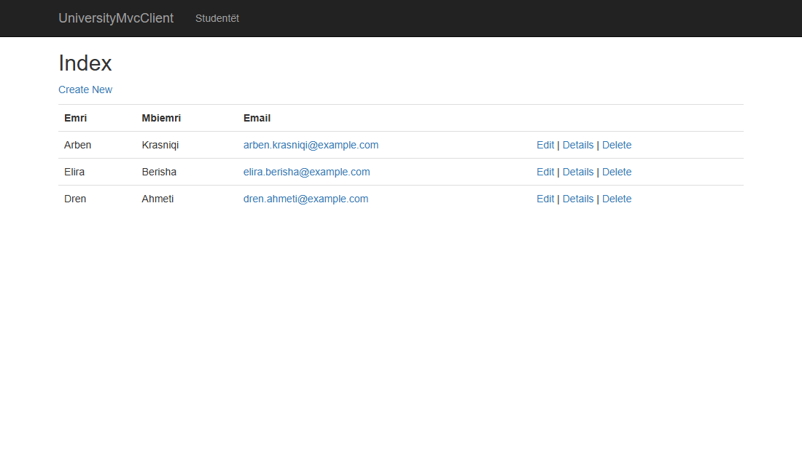

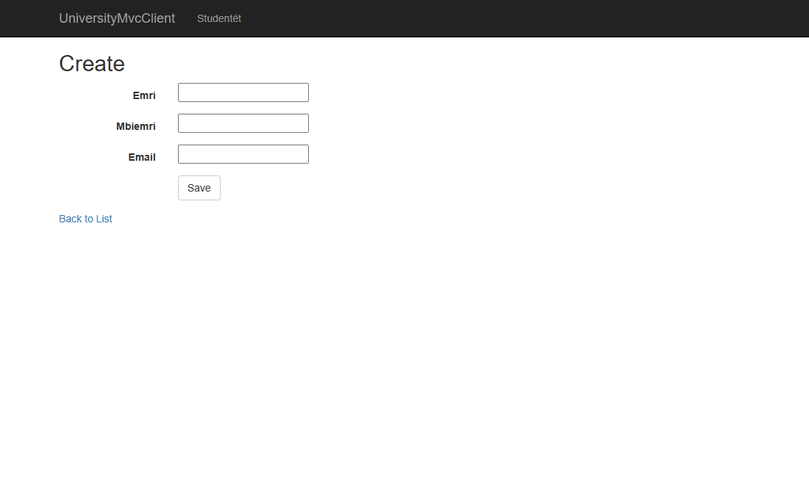

### Pika e kontrollit

- `/Students` te projekti MVC shfaq studentët nga API-ja.
- Create, Edit dhe Delete punojnë, dhe ndryshimet shihen edhe te `/api/students` dhe te faqja e Pjesës 6.
- CRUD i kurseve punon (ushtrimi i pavarur).

### Pyetje kontrolli

1. Pse projekti MVC nuk ka nevojë për CORS?
2. Cila metodë e `HttpClient` përputhet me foljen PUT?
3. Pse `HttpClient` është `static` te `ApiClient`?
4. Pse metodat e controller-it janë `async` dhe përdorin `await`?

## Pjesa 8: Publikimi në Azure (App Service dhe Azure SQL) (15 min)

### Teoria

Deri tani API-ja ekzekutohet vetëm në kompjuterin tënd (IIS Express dhe LocalDB). Që të përdoret nga të tjerët, duhet të publikohet në një server që është i ndezur gjithmonë. Në Azure kjo kërkon dy shërbime:

- **App Service**: ku ekzekutohet aplikacioni (Web API). Ne përdorim Windows me ASP.NET 4.8, sepse .NET Framework punon vetëm në Windows.
- **Azure SQL Database**: zëvendëson LocalDB. LocalDB ekziston vetëm në kompjuterin tënd, ndaj App Service nuk mund ta arrijë.

Visual Studio lidhet me App Service përmes **publish profile**, një skedari që përmban adresën e serverit dhe kredencialet e publikimit. Ai gjithashtu e ndërron connection string-un e LocalDB me atë të Azure SQL dhe ekzekuton migrations në databazën e re.

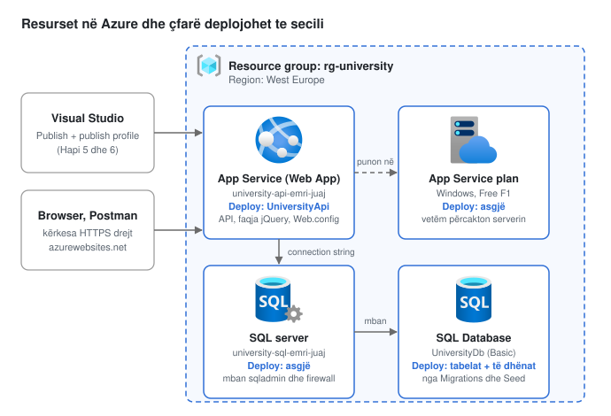

### Hapat

**Hapi 1: Resource group**

1. Hap [portal.azure.com](https://portal.azure.com) dhe kliko **Create a resource → Resource group** (ose kërko "Resource groups" → **Create**).
2. **Resource group:** `rg-university`, **Region:** `West Europe`. Kliko **Review + create → Create**.

Resource group është folderi që mban të gjitha resurset e ushtrimit. Në fund e fshin një herë dhe fshihet gjithçka.

**Hapi 2: Azure SQL Database**

1. Kërko **SQL databases** → **Create**.
2. Te skeda **Basics**:
   - **Resource group:** `rg-university`
   - **Database name:** `UniversityDb`
   - **Server:** kliko **Create new** → **Server name:** `university-sql-emri-juaj` (duhet të jetë unik në botë, vetëm shkronja të vogla, numra dhe viza), **Location:** `West Europe`, **Authentication method:** *Use SQL authentication*, **Server admin login:** `sqladmin`, një **Password** i fortë. Ruaje password-in diku, sepse nuk shfaqet më. Kliko **OK**.
   - **Workload environment:** *Development*. Nëse shfaqet **Compute + storage**, zgjidh **Basic** ose *serverless* (më i lirë).
3. Te skeda **Networking**:
   - **Allow Azure services and resources to access this server:** *Yes*
   - **Add current client IP address:** *Yes*
4. Kliko **Review + create → Create**. Prit 1-3 minuta.

**Hapi 3: Connection string i Azure SQL**

1. Hap databazën `UniversityDb` → **Settings → Connection strings**.
2. Kopjo vlerën e skedës **ADO.NET (SQL authentication)**.
3. Zëvendëso `{your_password}` me password-in tënd dhe fshi shenjat `{ }`. Në fund shto `MultipleActiveResultSets=True;`, si te connection string-u i LocalDB. Duhet të duket kështu:

```text
Server=tcp:university-sql-emri-juaj.database.windows.net,1433;Initial Catalog=UniversityDb;Persist Security Info=False;User ID=sqladmin;Password=PASSWORDI-JUAJ;MultipleActiveResultSets=True;Encrypt=True;TrustServerCertificate=False;Connection Timeout=30;
```

Ruaje në një skedar të përkohshëm (Notepad). Do e përdorësh në Hapin 6.

**Hapi 4: App Service**

1. Kërko **App Services** → **Create → Web App**.
2. Te skeda **Basics**:
   - **Resource group:** `rg-university`
   - **Name:** `university-api-emri-juaj` (unik; bëhet adresa `https://university-api-emri-juaj.azurewebsites.net`)
   - **Publish:** *Code*
   - **Runtime stack:** *ASP.NET V4.8*
   - **Operating System:** *Windows*
   - **Region:** `West Europe`
   - **Pricing plan:** kliko **Create new**, dhe te **Pricing plan** zgjidh **Free F1** (te **Explore**)
3. Te skeda **Deployment**, nëse sheh **Basic authentication**, zgjidhe **Enable**. Publish profile punon vetëm me këtë opsion të ndezur.
4. Kliko **Review + create → Create**, pastaj **Go to resource**.

Nëse e ke krijuar pa e ndezur, hap App Service → **Settings → Configuration → General settings** dhe vendos **SCM Basic Auth Publishing Credentials** në *On*, pastaj **Save**.

**Hapi 5: Shkarko publish profile**

1. Te faqja **Overview** e App Service kliko **Download publish profile** (në menynë e sipërme, ose te **Get publish profile**).
2. Shkarkohet skedari `university-api-emri-juaj.PublishSettings`. Ruaje jashtë folderit të projektit.

> **Kujdes:** skedari përmban password-in e publikimit. Mos e ngarko në GitHub dhe mos e ndaj me të tjerët.

**Hapi 6: Publiko nga Visual Studio**

1. Te projekti `UniversityApi` kliko me të djathtën → **Publish**.
2. Kliko **Add a publish profile → Import Profile** dhe zgjidh skedarin `.PublishSettings`. Kliko **Finish**.
3. Kliko **Show all settings** (ose **More actions → Edit**), pastaj hap skedën **Settings**:
   - **Configuration:** `Release`
   - Zgjero **Databases**. Te rreshti `UniversityContext` ngjit connection string-un e Hapit 3 te **Connection string**.
   - Vendos shenjën te **Execute Code First Migrations (runs on application start)**.
4. Kliko **Save**, pastaj **Publish**. Prit derisa te **Output** shfaqet `Publish succeeded`.

Me këto cilësime Visual Studio ndërron connection string-un te `Web.config` i publikuar (kopja në kompjuterin tënd mbetet me LocalDB). Migrations ekzekutohen kur aplikacioni merr kërkesën e parë, dhe me ta edhe metoda `Seed`.

**Hapi 7: Provo API-n në Azure**

1. Në browser hap `https://university-api-emri-juaj.azurewebsites.net/api/students`. Kërkesa e parë zgjat disa sekonda, sepse në atë moment krijohen tabelat dhe studentët fillestarë. Duhet të shohësh të njëjtin JSON si në Pjesën 4.
2. Hap `https://university-api-emri-juaj.azurewebsites.net/Home/Students`. Faqja jQuery punon pa ndryshim, sepse përdor adresë relative (`/api/students`).
3. Në Postman ndrysho adresën bazë nga `http://localhost:5050` në adresën e Azure dhe përsërit testet nga Pjesa 5. Kodet e statusit duhet të jenë të njëjta.
4. Provo edhe databazën: në Azure Portal hap `UniversityDb` → **Query editor**, hyr me `sqladmin` dhe ekzekuto `SELECT * FROM Students`.

**Hapi 8: Fshi resurset (rëndësishme)**

Kur të përfundosh, hap **Resource groups → `rg-university` → Delete resource group**, shkruaj emrin dhe konfirmo. Kështu nuk ngelen shërbime që mund të kushtojnë.

### Pika e kontrollit

- `https://emri-juaj.azurewebsites.net/api/students` kthen listën e studentëve.
- Faqja `/Home/Students` në Azure shfaq tabelën dhe lejon Shto dhe Fshij.
- Në Postman, POST kthen 201 dhe GET me Id që nuk ekziston kthen 404, në adresën e Azure.
- Në Query editor tabela `Students` ka të dhënat.

### Pyetje kontrolli

1. Pse API-ja nuk mund të përdorë LocalDB pasi publikohet në Azure?
2. Çfarë përmban publish profile dhe pse nuk duhet ndarë me të tjerët?
3. Pse kërkesa e parë te API-ja në Azure zgjat më shumë se të tjerat?
4. Pse faqja jQuery nuk ka nevojë për ndryshim pas publikimit?

### Gabimet e zakonshme në Azure

- **Publish dështon me gabim autentikimi:** Basic authentication është i fikur. Ndize siç tregon Hapi 4 dhe shkarko publish profile të ri.
- **`Cannot open server ... requested by the login`:** emri i serverit ose firewall. Kontrollo që **Allow Azure services** është *Yes* te SQL server → **Networking**.
- **`Login failed for user 'sqladmin'`:** password-i në connection string është gabim ose ka ngelur me `{ }`.
- **`/api/students` kthen 500 dhe databaza është bosh:** nuk është vënë shenja te **Execute Code First Migrations**, ose connection string-u është ngjitur te rreshti i gabuar. Rishiko Hapin 6 dhe publiko përsëri.
- **Faqja hapet shumë ngadalë pas pak kohe pa përdorim:** plani Free e fle aplikacionin kur nuk përdoret. Kërkesa e parë e zgjon.

## Përmbledhje dhe detyra për ushtrim

Ndërtove një Web API për studentë dhe kurse dhe e përdore nga katër klientë: browser-i, Postman, një faqe me jQuery dhe një projekt MVC. Të gjithë përdorin të njëjtën API, me të njëjtat folje HTTP dhe të njëjtat kode statusi. Në fund e publikove API-n në Azure (App Service dhe Azure SQL), kështu që çdokush mund ta përdorë përmes internetit.

| Klienti | Kush dërgon kërkesën | Ku ekzekutohet | Duhet CORS? |
| --- | --- | --- | --- |
| Postman | Ti, me dorë | Në kompjuterin tuaj | Jo |
| Faqe jQuery brenda projektit | Browser-i | Në browser | Jo (e njëjta origjinë) |
| Faqe HTML në Desktop | Browser-i | Në browser | Po |
| Projekti MVC | Serveri MVC (`HttpClient`) | Në server | Jo |

### Gabimet e zakonshme

- API-ja nuk është e nisur kur provon klientin. Shtyp Ctrl+F5 te projekti `UniversityApi`.
- Porti nuk përputhet: `BaseAddress` ose URL-ja në Postman përdor një port tjetër nga 5050.
- Harrove `Update-Database`: do shohësh gabim që përmend `Invalid object name`.
- Në Postman mungon **Body → raw → JSON**: API merr objekt bosh dhe kthen 400.
- Mungon `[JsonIgnore]`: gabim serializimi pasi Student → Enrollments → Student bën ciklë.
- Mungon `db.SaveChanges()`: kërkesa kthen sukses, por asgjë nuk ruhet në databazë.

### Detyra për ushtrim

1. Shto fushën `Phone` te `Student` në API: ndrysho klasën, ekzekuto `Add-Migration AddStudentPhone` dhe `Update-Database`. Pastaj shtoje te faqja jQuery dhe te projekti MVC.
2. Në projektin MVC krijo faqen `Enrollments` që liston regjistrimet (emri i studentit dhe titulli i kursit) nga `/api/enrollments`.
3. Në API shto kërkimin sipas mbiemrit: `GET /api/students?lastName=Krasniqi`. Ndihmë: shto parametrin `string lastName = null` te `GetStudents` dhe filtro me `Where` kur nuk është bosh. Provoje në Postman.
4. Sfidë: te faqja jQuery shto butonin **Edito** që dërgon kërkesë PUT.
